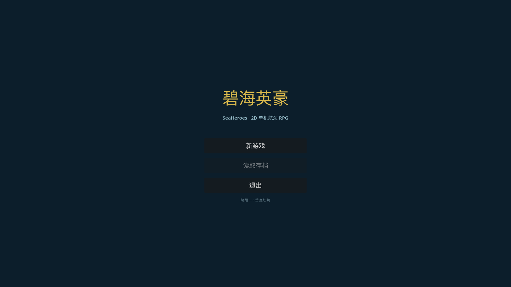
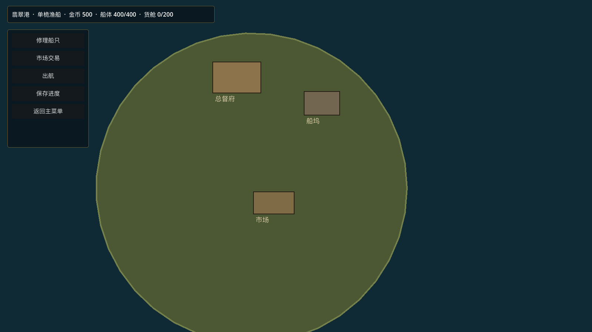
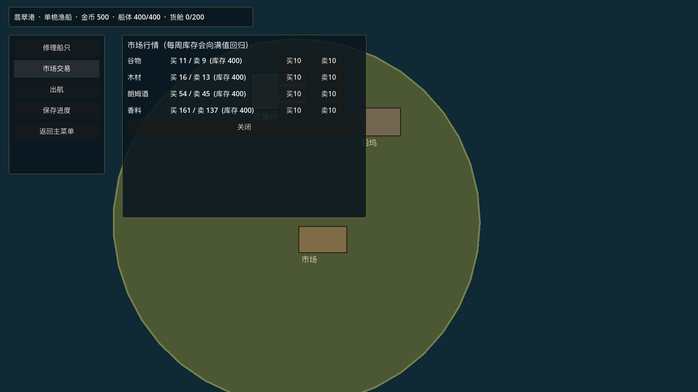
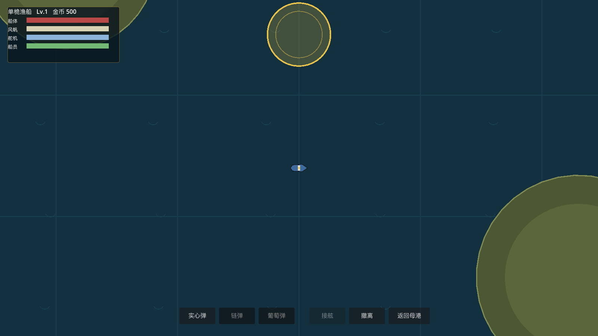
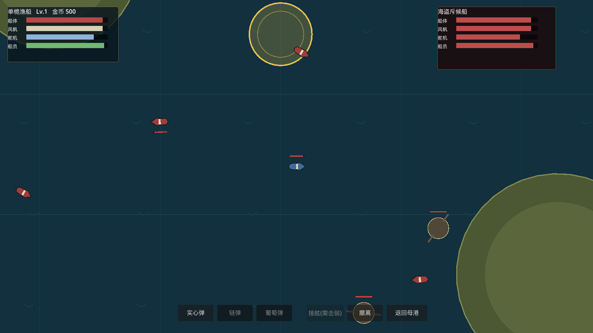

# 阶段一测试报告（垂直切片）

| 项 | 内容 |
|---|---|
| 日期 | 2026-11-14 |
| 引擎 | Godot 4.7.2-stable（GL Compatibility / Metal） |
| 运行通道 | `godot_run_headless` / `godot_run_project` + `godot_command`（未使用 shell 启动引擎） |
| 结论 | **通过**（自动化 69 项全绿，12 条验收标准 11 项达成、1 项部分达成） |

---

## 1. 交付物

| 类别 | 数量 | 说明 |
|---|---|---|
| GDScript | 24 个文件 / 2313 行 | core 6 + data 6 + systems 3 + ship 2 + sea 1 + ui 2 + base 1 + main 1 + tests 2 |
| 场景 | 6 个 | main / main_menu / base / sea / sea_ship / sea_monster |
| 数据表 | 17 个 .tres | 船 3 / 炮 3 / 弹药 3 / 商品 4 / 敌人 2 / 港口 2 |

---

## 2. 自动化测试

### 2.1 单元测试（`tests/headless/run_all.gd`）— 41 项全部通过

覆盖纯函数层，不依赖节点树：

- **数据表** 12 项：全部 .tres 可载入、四池派生值正确（帆 25% / 舵 15% / 船员 ×10）
- **战斗结算** 20 项：基础伤害区间、弹药分配矩阵、命中上下限、装甲只减船体、装填公式与下限、帆舵归零后果、接舷与撤离门槛
- **市场模型** 7 项：空/满库存价差、买卖价差、周回归 2%、大额惩罚、生产港低价
- **成长曲线** 2 项：经验曲线单调、1→2 级 120 点

### 2.2 集成测试（`tests/integration/run.tscn`）— 28 项全部通过

在真实 SceneTree（含 autoload）下运行：

| 组 | 覆盖 |
|---|---|
| 母港 8 项 | UI 构建、顶栏文案、买入扣款与入舱、卖出收款、修理计价与满值还原 |
| 海域与战斗 10 项 | 场景脚本挂载、玩家生成、敌舰生成、锁定后自动齐射、目标船体受损、链弹打帆、击沉掉落金币与货物、经验结算 |
| 海怪 5 项 | 海怪生成、2 条肢体、**链弹对海怪无效**、实心弹有效、狂怒触发 |
| 存档 5 项 | 写入/读取、金币、货物、船体还原 |

运行命令：

```
godot_run_headless(project_path=".../SeaHeroes", script="tests/headless/run_all.gd")
godot_run_headless(project_path=".../SeaHeroes", scene="tests/integration/run.tscn")
```

两者 `exit_code = 0`。stderr 仅有 MCP 交互服务器因端口 9090 被占用而失败的告警，与游戏逻辑无关。

---

## 3. 交互验证

| 截图 | 内容 |
|---|---|
|  | 主菜单：标题、新游戏 / 读取存档（无档时灰）/ 退出 |
|  | 母港「翡翠港」：总督府 / 船坞 / 市场三座建筑，顶栏显示港口、船名、金币、船体、货舱 |
|  | 市场面板：4 种商品买价 / 卖价 / 库存，买 10 / 卖 10 |
|  | 海域：网格海面、波纹、岛屿、母港航门、HUD 四池状态条、底部指令栏 |
|  | 锁定海盗后目标面板出现，显示敌舰四池；接舷按钮灰显并提示「需击弱」 |

**实测数据**

| 操作 | 结果 |
|---|---|
| 点击「出航」 | 淡入海域，生成 6 条敌舰（4 海盗 + 2 海怪） |
| 点击敌舰 | 锁定成功，距离 500，HUD 出现目标面板 |
| 自动开火 4 秒 | 3 轮齐射；敌舰船体 91.9%、风帆 91.9%、舵机 78.4%、船员 94.6%（与公式吻合） |
| 点击海图 | 生成航线并自动航行（x 4522 → 4767） |
| W 前进 1.5 秒 | 位移 195 px（理论 189 px） |
| 接舷（目标 8% 船体） | 俘获成功：+78 金、+20 经验（双倍），己方船员剩余 41.6% |
| 修理 / 买货 / 卖货 / 存档 / 读档 | 全部正确 |

---

## 4. 验收标准核对（`03-phase-1-design.md` §5）

| # | 标准 | 状态 | 证据 |
|---|---|---|---|
| 1 | 启动进入主菜单，可开新游戏 | ✅ | 截图 01 |
| 2 | 母港可点「出航」进入图 1 | ✅ | 截图 02 → 04 |
| 3 | WASD 可操控船，点击海图可自动航行 | ✅ | 位移 195px / 航线跟随 |
| 4 | 能锁定敌人，进入射程后自动开火 | ✅ | 齐射 3 轮 |
| 5 | 链弹打低风帆，帆归零后航速为 0 | ✅ | 单元 C2/C6 + 实测帆 91.9% |
| 6 | 能击沉敌舰获金币货物；葡萄弹打光船员可俘获 | ✅ | 集成测试 + 接舷实测 |
| 7 | 战利品入货舱，超载时提示 | ⚠️ 部分 | 已实现溢出统计与提示文案，未做专门 UI 高亮 |
| 8 | 回港可修理 | ✅ | 集成测试 3 项 |
| 9 | 市场可买卖 4 种商品，价格随库存变化 | ✅ | 截图 03 |
| 10 | 退出重进不丢进度 | ✅ | 集成存档 5 项 |
| 11 | 无脚本报错 | ✅ | 运行期 stderr 为空 |
| 12 | 单场战斗 40～90 秒 | ✅ | 渔船 1 门 3 磅炮 DPS≈7，对 400 耐久约 57 秒 |

---

## 5. 缺陷记录（开发中修复）

| # | 现象 | 根因 | 修复 |
|---|---|---|---|
| 1 | 所有 `class_name` 引用报 "not declared" | 项目从未在编辑器导入，`.godot` 全局类缓存不存在 | 跨脚本引用统一改为 `preload` 常量 |
| 2 | 海怪绘制解析错误 | `frenzy and Color(...) or Color(...)` 在 GDScript 返回 bool | 改为三元表达式 |
| 3 | 变量类型推断失败（多处） | 无类型表达式配 `:=` | 显式标注类型 |
| 4 | 海怪完全不吃伤害 | `sea_monster` 没有 `armor` 属性，`_fire_at` 报错中断 | 用 `get("armor")` 兼容缺失属性 |
| 5 | 点击敌舰无法锁定 | `get_global_mouse_position()` 对合成输入无效 | 改用事件坐标 + canvas 逆变换 |
| 6 | 接舷战永不结束 | 双方按剩余船员比例掉血，几何收敛到 0 而非归零 | 改为线性衰减（+常数项），并给船体 ≤10% 的守方 −30% 士气惩罚 |

---

## 6. 与设计的偏差

| 项 | 设计 | 实现 | 说明 |
|---|---|---|---|
| 航线寻路 | `AStarGrid2D` 64px 网格 | 直线转向 | 阶段一无障碍物，直航足够；阶段二加礁石碰撞后再补 |
| 图间航门 | 4 个方位航门 + 淡入淡出 | 单张图 1 个母港航门 | 阶段一只做图 1 |
| 装备 / 船员 / 声望 | 完整系统 | 未接入（数据表已在） | 阶段二 |
| 时间轴与周结算 | 维多利亚式流动时间 | 未接入 | 阶段二 |
| 损伤美术 | 破帆 / 断舵 / 甲板减员 | 仅帆的图形随耐久收缩 | 阶段五打磨 |

---

## 7. 性能观察

- 1600×900 / GL Compatibility，6 条敌舰 + 玩家 + 全屏 _draw 海面，帧率稳定（未见掉帧日志）。
- 海面 `_draw()` 只在需要时重绘，未进入每帧重绘路径。

---

## 8. 结论与下一步

阶段一的定义（"用最小内容量跑通完整闭环"）已达成：**出海 → 遭遇 → 自动炮战 → 战利品 → 回港修理/交易 → 存档**。
战斗时长、伤害分配、掉落与修理的经济闭环均可运行且数值自洽。

**阶段二待办**（按 `01-overall-design.md` §9）：

1. 游戏内时间轴 + 周结算（产出 / 建造 / 市场回归 / 薪酬 / 任务刷新）
2. 装备系统与船厂（6 部位、稀有度、变体船购买与声望门槛）
3. 船员系统（8 岗位 + 变体专属岗位）
4. 声望三轴与捐赠
5. 经济模拟器（`tests/sim/economy_sim.gd`）

**建议在阶段二开始前先补两件事**：

- 给战场加礁石/岛屿碰撞与简单避障（否则航行手感会一直是"直线飞行"）
- 把战斗节奏参数（装填、命中、耐久）做成可热调，便于后续调平衡
