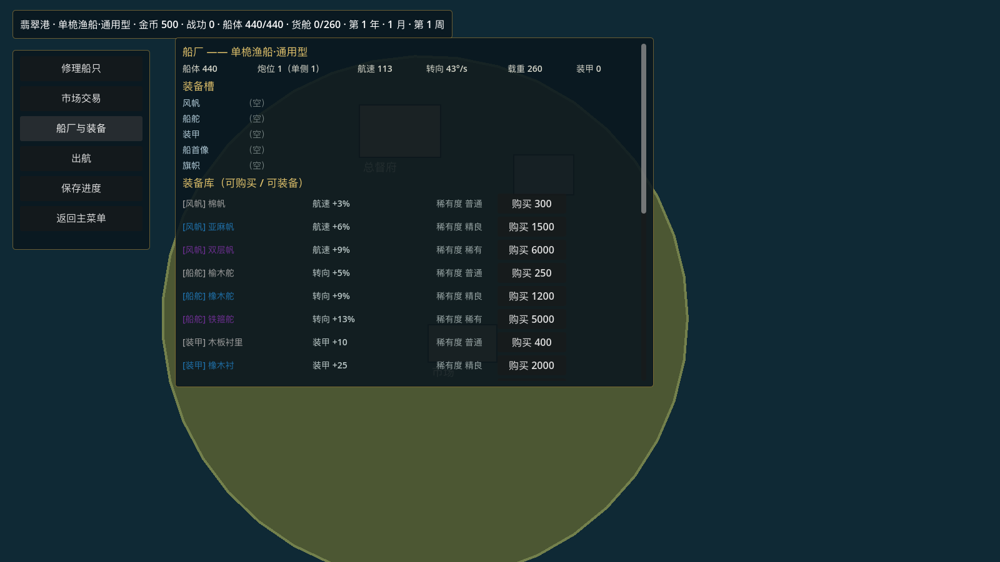
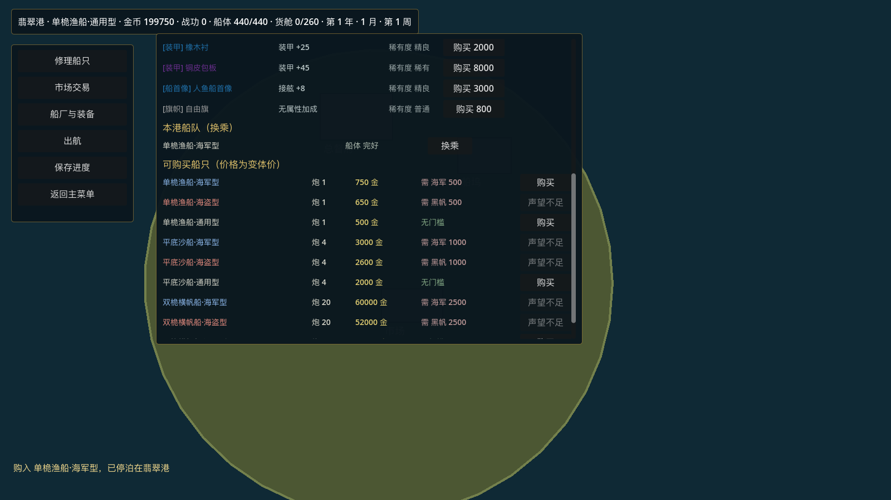
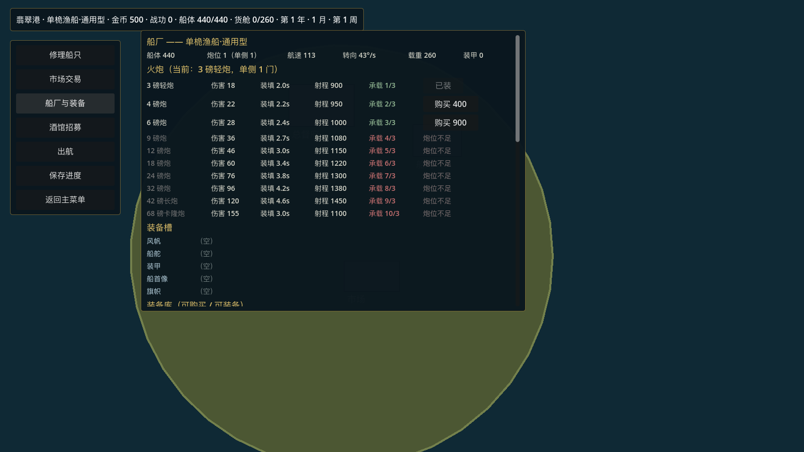
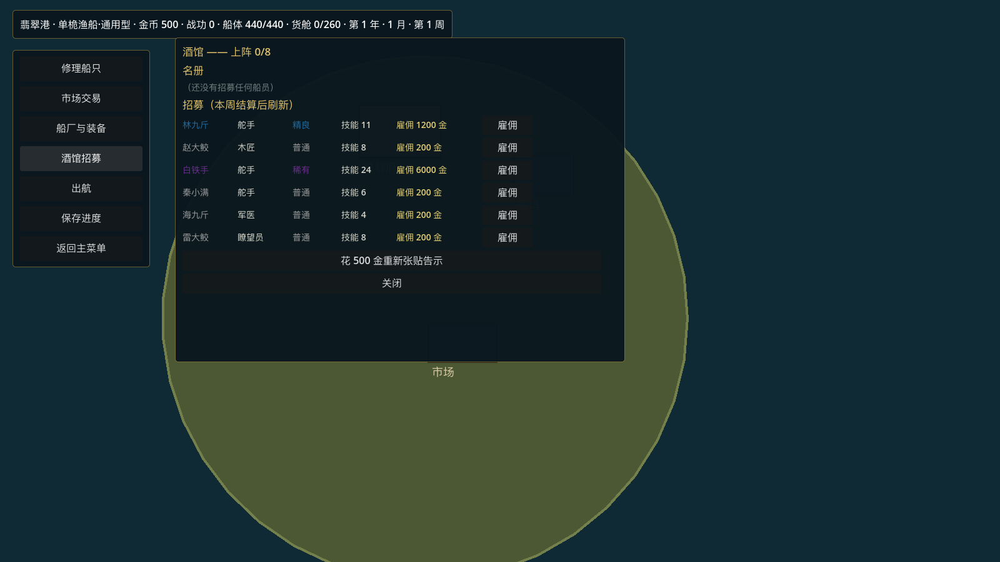
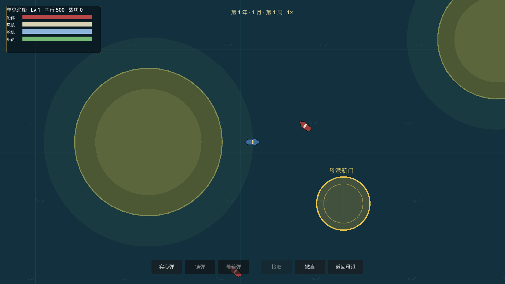

# 阶段二测试报告（第一批交付）

| 项 | 内容 |
|---|---|
| 日期 | 2026-11-16 |
| 范围 | 第一批：碰撞避障 · 双货币 · 时间轴与周结算 · 热参数；第二批：装备与船厂；第三批：火炮换装 · 船员系统 |
| 结论 | **通过**（自动化 148 项全绿，实机验证 11 项） |
| 设计依据 | `02-systems-design.md` §1.5 / §5 / §8.6 / §17 / §20 |

---

## 1. 本批交付

| # | 项目 | 文件 |
|---|---|---|
| 1 | **关闭船体碰撞**：船↔船、船↔怪 mask 置 0 | `sea_ship.gd` / `sea_monster.gd` |
| 2 | **岛屿软约束**：排斥区 = 岛半径 + 150，斥力 900，场内减速 0.55，压上岛触发搁浅 | `sea_scene.gd` |
| 3 | **点击绕行**：线段–圆相交时插入一个绕航点 | `sea_scene.gd` / `sea_ship.gd` |
| 4 | **双货币**：金币 + 战功，战功不可购买不可兑换 | `game_state.gd` / `loot_system.gd` / HUD |
| 5 | **时间轴**：1 游戏日 = 24 现实秒，暂停 / 1× / 2× / 4× | `time_service.gd`（autoload） |
| 6 | **周结算**：每周回归港口库存、薪酬结算调用点 | `world_tick.gd`（autoload） |
| 7 | **热参数第一层**：全部公式常量抽到 `balance_config.tres`，F5 热重载 | `balance_config.gd` / `combat_resolver.gd` / `market_model.gd` / `data_registry.gd` |

---

## 2. 第二批交付：装备系统与船厂

### 2.1 新增内容

| # | 项目 | 说明 |
|---|---|---|
| 1 | **GearDef 装备数据** | 5 个部位（风帆 / 船舵 / 装甲 / 船首像 / 旗帜），11 件装备分 N/R/SR 三档 |
| 2 | **稀有度配色** | `Rarity` 统一出图：灰 / 海蓝 / 罗马紫 / 黄金 / 品红（UR 待换 shader） |
| 3 | **ShipStats 结算层** | 纯函数：基准模板 × 变体倍率 × 装备加成 → 最终船体/航速/转向/装甲/炮位/载重 |
| 4 | **三变体派生** | 3 个基准模板自动派生 9 个变体船体（id 形如 `brig_navy`），不手填 30 张表 |
| 5 | **声望门槛** | 海军型 / 海盗型 = 500 × 等级；通用型无门槛；商店按钮按声望灰显 |
| 6 | **船厂面板** | 当前船属性、5 个装备槽（装/卸）、装备库（买/装）、本港船队换乘、可购买船只 |
| 7 | **船队与换乘** | 每艘船记录 `station_port`；只能在停泊港换乘；换下的船回到船队 |
| 8 | **存档扩展** | 变体、装备槽、装备库、船队全部可存读 |

### 2.2 实机验证

| 项 | 实测 |
|---|---|
| 装备库列表 | 11 件装备按槽位分组，稀有度用灰/海蓝/罗马紫区分，价格正确 |
| 买装备 | 橡木衬 2000 金，购买后进入装备库，装备后装甲 0 → 25 |
| 声望门槛 | 海军声望 0 时「单桅渔船·海军型」按钮显示"声望不足"且不可点 |
| 声望达标 | 声望置 600 后按钮恢复「购买」，点击后扣 750 金、船队 +1 |
| 换乘 | 船队出现「单桅渔船·海军型 · 船体完好 · [换乘]」 |
| 变体价格 | 平底沙船 通用 2000 / 海军 3000 / 海盗 2600，与倍率表一致 |

---

## 3. 第三批交付：火炮换装与船员系统

### 3.1 火炮换装

| # | 项目 | 说明 |
|---|---|---|
| 1 | 10 级火炮表补全 | 3 / 4 / 6 / 9 / 12 / 18 / 24 / 32 / 42 磅 + 68 磅卡隆炮，pound_class 1~10 无缺号 |
| 2 | 瞄准位承载 | `can_mount_cannon()` 用 `ShipDef.max_cannon_weight` 校验；渔船上限 3、沙船 6、横帆船 10 |
| 3 | 火炮槽与火炮库 | `GameState.cannon_id` + `cannons_owned`，随船存档、随换船迁移 |
| 4 | 出海生效 | `sea_ship.setup_player` 从 `GameState.cannon_id` 读伤害/装填/射程/命中修正 |

实测：渔船（承载 3）只能装 1~3 级炮，9 磅及以上显示"炮位不足"并灰显；换装 4 磅炮后出海，船实际伤害 22、射程 950。

### 3.2 船员系统

| # | 项目 | 说明 |
|---|---|---|
| 1 | `CrewDef` + `CrewFactory` | 酒馆随机生成 6 名候选：姓名 / 岗位 / 稀有度 / 技能 / 薪酬 / 雇佣金 |
| 2 | 10 个岗位 | 舵手 / 大副 / 炮手 / 瞭望员 / 水手长 / 木匠 / 军医 / 操帆长 + 海军型「征税官」/ 海盗型「突击队长」 |
| 3 | 槽位按变体 | 通用型 8 / 海军型 12 / 海盗型 9 |
| 4 | 效果接入战斗 | 舵手→转向、大副→装填、炮手→命中（封顶 +0.35）、水手长/操帆长→航速、突击队长→接舷 +25% |
| 5 | 酒馆界面 | 名册（上阵/下阵/解雇）、招募池、花 500 金刷新 |
| 6 | 存档 | 名册与上阵状态随存档保存 |

实测：招募 6 名候选正常生成、稀有度配色正确（灰/海蓝/罗马紫）；雇佣扣款、上阵后槽位计数变化、存档往返均通过。

---

## 4. 自动化测试

| 套件 | 项数 | 结果 | 第三批新增 |
|---|---|---|---|
| 单元 `tests/headless/run_all.gd` | 65 | 全过 | +6 船员加成用例 |
| 集成 `tests/integration/run.tscn` | 83 | 全过 | +21 火炮 / 船员 / 存档用例 |

新增用例清单：

**热参数（单元）**

| 用例 | 期望 |
|---|---|
| `armor_k` 调大后装甲减伤变弱 | 通过 |
| `reset_defaults()` 还原 | 通过 |
| `hit_base` 调低后命中贴近下限 | 通过 |
| `price_elasticity = 0` 时空/满库存同价 | 通过 |
| 恢复默认后价格重新拉开 | 通过 |
| `xp_a` 可调 | 通过 |

**避障 / 时间 / 货币（集成）**

| 用例 | 期望 |
|---|---|
| 进入避障区后被推出 | 距离 450 → 508 |
| 跨岛航线插入绕航点 | route.size() == 2 |
| 不跨岛航线不加绕航点 | route.size() == 1 |
| 船不与任何实体碰撞 | collision_mask == 0 |
| 海怪不与任何实体碰撞 | collision_mask == 0 |
| 24 秒推进 1 天 | total_days 0 → 1 |
| 暂停时不推进 | total_days 不变 |
| 2× 速度 12 秒推进 1 天 | 通过 |
| 跨周触发一次周结算 | 1 次 |
| 击沉带战功奖励的敌人后战功 +5 | 通过 |
| 战功存档还原 | 42 → 42 |
| 时间轴存档还原 | 30 天 → 30 天 |

---

## 5. 第一批实机验证

| 项 | 实测 |
|---|---|
| 时间显示 | 顶栏 "第 1 年 · 1 月 · 第 1 周 1×"，4× 加速 7 秒推进 1 天（理论 1.17） |
| 岛屿斥力 | 把船放到距岛心 450 px 处，1.8 秒后被推到 508 px（排斥边界 510） |
| 船体碰撞 | 海图上有船与船重叠，符合原作 |
| 热重载 | `DataRegistry.reload_all()` 后 `armor_k` 仍为 120，无报错 |
| HUD 层级 | CanvasLayer 提到 layer 10，世界物体不再压住按钮 |

---

## 6. 发现并修复的缺陷

| # | 现象 | 根因 | 修复 |
|---|---|---|---|
| 1 | 跨周结算测试计数恒为 0 | **GDScript lambda 按值捕获**，`weeks += 1` 改的是副本 | 用单元素数组（引用类型）承载计数 |
| 2 | 世界物体绘制在 UI 之上 | CanvasLayer 默认 layer=1，与场景节点层级接近 | HUD 统一 layer=10 |
| 3 | `res.to_dict()` 静态类型检查报错 | 变量声明为 `Resource`，方法不在基类 | 去掉类型标注 + 用 `call("to_dict")` |
| 4 | 变体船名出现"（海军型）·海军型"重复 | `_build_variants` 追加了后缀，UI 又拼了一次 | 派生时只改 id 与价格，名称由 UI/HUD 拼 |
| 5 | 修理测试失败 | 船体上限从基准值改为变体值后，断言仍用 `base_hp` | 断言改用 `GameState.hull_max()` |
| 6 | `ShipStats.compute` 编译失败 | 返回字典里 `crew_slots` 键重复出现两次 | 删掉后加的那份 |
| 7 | 母港顶栏金币不随交易刷新 | 只监听按钮回调，没监听 `EventBus.gold_changed` | 连接该信号并复用 `_refresh()` |

---

## 5. 与设计的偏差

| 项 | 设计 | 实现 | 说明 |
|---|---|---|---|
| 搁浅惩罚 | 停 2 秒 + 耐久 −2% | 耐久 −2%（1.5 秒冷却）+ 强斥力 | 未做"停 2 秒"的定身，因为软约束已能推开，定身反而容易卡死 |
| 周结算内容 | 产出 / 建造 / 市场 / 薪酬 / 任务 | 目前只有市场回归 + 薪酬调用点 | 产出与建造依赖基地系统（阶段三），任务依赖阶段四 |
| 热参数第二层 | 表达式化 | 未做 | 按计划排在阶段三 |
| 装备稀有度 | SSR / UR 五档 | 数据只做了 N/R/SR 三档 | 高阶装备等 UR 材料系统一起做 |
| 火炮槽 | 火炮也是装备槽 | **已实现**，整船同型号、受炮位承载限制 | 混装不同磅级留到后续 |
| 船厂滚动 | 鼠标滚轮 | 用合成事件无法验证滚动，改用 `scroll_vertical` 直接验证内容 | 真实玩家滚轮走正常输入通路，可用 |

---

## 6. 阶段二剩余工作

| 优先级 | 内容 | 依赖 |
|---|---|---|
| 高 | **装备系统与船厂**（6 部位、稀有度、变体船购买与声望门槛） | 无，可立即开始 |
| — | ~~火炮换装~~ | **已完成** |
| — | ~~船员系统~~ | **已完成**（木匠 / 军医 / 侦察加成留待与修理、伤亡系统一起接） |
| 中 | **声望三轴与捐赠** | 需要任务系统提供获取途径 |
| 中 | **经济模拟器**（headless 跑 1000 次行为出曲线） | 需要装备与船厂定价 |
| 低 | 热参数第二层（`Expression`） | 阶段三 |
