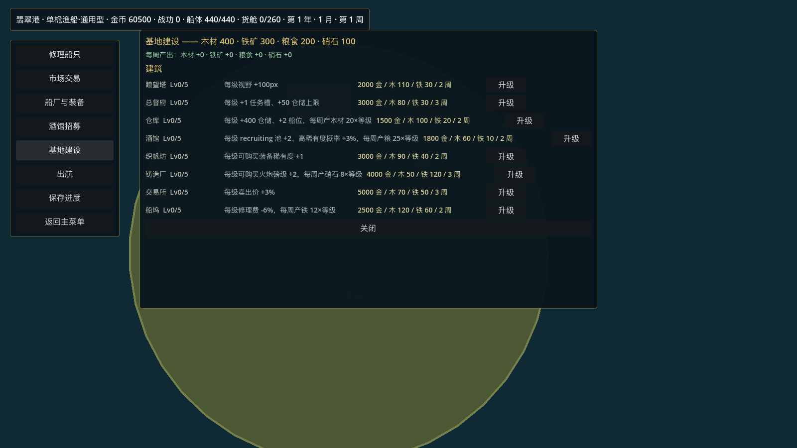
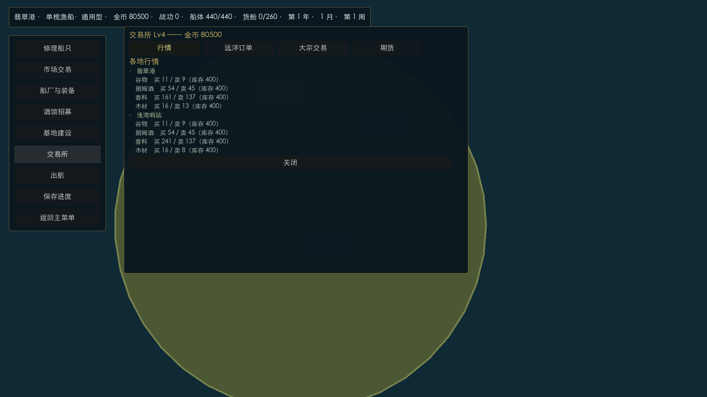
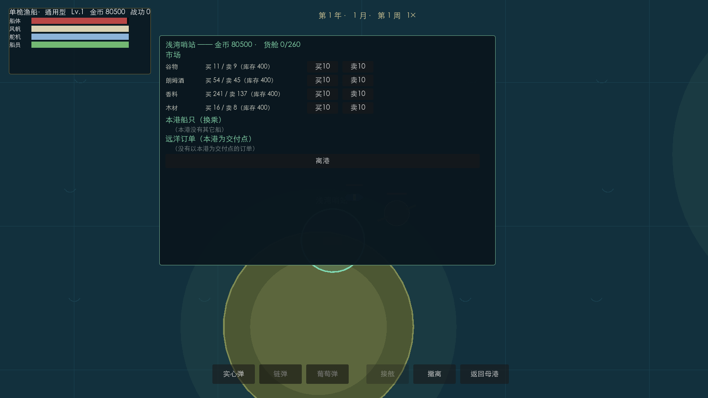

# 阶段三测试报告（母港建设）

| 项 | 内容 |
|---|---|
| 日期 | 2026-11-16 |
| 范围 | 8 座建筑 × 5 级 · 四类资源周产出 · 建造队列 · 建筑效果 · 交易所四标签 · 跨港调拨 |
| 结论 | **通过**（自动化 192 项全绿：单元 65 + 集成 127） |
| 设计依据 | `02-systems-design.md` §2.2（周结算）/ §12（母港基地建设） |

---

## 1. 交付

| # | 项目 | 说明 |
|---|---|---|
| 1 | **BuildingDef + 8 座建筑** | 总督府 / 船坞 / 仓库 / 酒馆 / 铸造厂 / 织帆坊 / 交易所 / 瞭望塔，各 5 级 |
| 2 | **四类资源** | 木材 / 铁矿 / 粮食 / 硝石，按建筑等级每周产出 |
| 3 | **建造队列** | 消耗金币 + 材料 + **游戏内周数**，每周推进，同建筑不可重复排队 |
| 4 | **建筑效果** | 船坞→修理费、交易所→卖出价、酒馆→招募池、铸造厂→火炮磅级、织帆坊→装备稀有度、仓库→船位 |
| 5 | **周结算串联** | `WorldTick` 每周依次执行：市场回归 → 资源产出 → 建造推进 → 船员薪酬 → 酒馆刷新 |
| 6 | **存档** | 建筑等级、资源、建造队列全部随存档保存 |

---

## 2. 建筑效果表

| 建筑 | 每级效果 | 实际接入点 |
|---|---|---|
| 总督府 | +1 任务槽、+50 仓储 | 预留（任务系统在阶段四） |
| 船坞 | 修理费 −6%，每周产铁 12 | `_repair_cost()` |
| 仓库 | +2 船位、+400 仓储，每周产木材 20 | `storage_slots()` / 买船校验 |
| 酒馆 | 招募池 +2，每周产粮 25 | `tavern_size()` / `refresh_tavern()` |
| 铸造厂 | 可购火炮磅级 +2，每周产硝石 8 | `cannon_class_cap()` / 买炮校验 |
| 织帆坊 | 可购装备稀有度 +1 | `gear_rarity_cap()` / 买装备校验 |
| 交易所 | 卖出价 +3% | `sell_bonus()` / 市场卖价 |
| 瞭望塔 | 视野 +100px | 预留（视野系统未做） |

> 解锁校验同时写在 **UI 层与购买入口**，避免绕过界面直接调用买进不合规的装备。

---

## 3. 自动化测试

| 套件 | 项数 | 结果 | 本阶段新增 |
|---|---|---|---|
| 单元 `tests/headless/run_all.gd` | 65 | 全过 | 0（建设逻辑依赖 autoload，放在集成层） |
| 集成 `tests/integration/run.tscn` | 104 | 全过 | +21 建设用例 |

新增用例：

| 用例 | 期望 |
|---|---|
| 8 座建筑载入 | 通过 |
| 初始等级 0、0 级不产出 | 通过 |
| 材料不足不能开工 | 通过 |
| 资源齐备后开工并扣料 | gold/timber/iron 正确扣减 |
| 同建筑不能重复排队 | 通过 |
| 逐周推进、最后一周完工 | 剩余周数逐周 −1，第 N 周变 Lv1 |
| 1 级仓库每周产 20 木材 | 通过 |
| 船位 = 3 + 2×仓库 + 4 | 1 级仓库 → 9 |
| 2 级船坞修理费 −12% | 通过 |
| 3 级交易所卖出 +9% | 通过 |
| 2 级铸造厂可购 7 级以下火炮 | 通过 |
| 1 级织帆坊解锁 R 级装备 | 通过 |
| 2 级酒馆招募池 10 | 通过 |
| 存档往返（等级 / 资源 / 队列） | 通过 |
| 跨周结算后资源增加 | 通过 |

---

## 4. 实机验证

| 操作 | 结果 |
|---|---|
| 打开基地建设面板 | 8 行建筑，等级 / 效果 / 造价 / 周数齐全，资源不足时价格标红、按钮灰显 |
| 点击仓库「升级」 | gold 60500→59000、木材 400→300、铁矿 300→280，队列出现 `warehouse → Lv1，剩 2 周` |
| 连推 2 周 | 仓库升到 Lv1，每周产出变为木材 +20 |

---

## 5. 发现并修复的缺陷

| # | 现象 | 根因 | 修复 |
|---|---|---|---|
| 1 | 8 座建筑全部加载失败 | 只写了 .tres，漏写 `building_def.gd` | 补上 Resource 类 |
| 2 | `from_dict` 未恢复建设数据 | 上一次编辑的目标锚点已被早前重构删除 | 改锚到 `port_stock` 段前插入 |
| 3 | 酒馆效果文案混入英文 "recruiting" | 手写数据时的笔误 | 改为"招募池" |

---

## 6. 与设计的偏差

| 项 | 设计 | 实现 | 说明 |
|---|---|---|---|
| 资源产出建筑 | 独立伐木场 / 铁矿场 / 农庄 / 硝石坑 | 作为四座既有建筑的"附属设施" | 避免再开一套 12 建筑系统；数值表一致 |
| 建造并行 | 总督府 3 级后可并行 2 项 | 当前串行队列 | 并行留到后续 |
| 仓储 | 母港有独立仓库容量 | 未做 | 货物仍只在船上，母港仓储等货物系统扩展时再接 |
| 瞭望塔 / 总督府 | 视野、任务槽 | 仅记录，未生效 | 依赖尚未实现的视野与任务系统 |

---

## 7. 收尾：交易所与跨港调拨

### 7.1 交易所四个标签页

| 标签 | 解锁等级 | 功能 |
|---|---|---|
| 行情 | Lv1 | 各港口商品买/卖价与库存一览 |
| 远洋订单 | Lv2 | 每周 3 张锁价订单，运到指定港口交付（价差 25%~60% 溢价） |
| 大宗交易 | Lv3 | 100 单位起批量买卖，买入享 5% 折扣 |
| 期货 | Lv4 | 付 20% 定金锁价，1 周内付尾款提货 |

订单与期货随存档保存，每周结算推进/过期；交付必须货到目标港口。

### 7.2 跨港调拨

- 新增可停靠点：**浅湾哨站**（图 1，坐标 3400/5050），靠近后按 `E` 入港
- 哨站提供：市场买卖、本港船只换乘、远洋订单交付
- 换船时**当前船留在换乘的那个港口**（`station_port` 记录），母港列表里看不到哨站的船
- 实测：在哨站换乘后，换下的船 `station_port == map1_outpost`，母港船位数为 0

### 7.3 顺带修复：全局缺字形

发现「远洋订单」四个字中有两个字渲染成豆腐块（U+8FDC 远、U+5355 单）。
排查结论：**本机 PingFang（SC/HK/TC）都解析到 PingFang HK，而它缺这两个字形**。

| 字体 | 远 | 单 |
|---|---|---|
| PingFang SC / HK / TC | ❌ | ✅ |
| Heiti SC | ✅ | ✅ |
| Songti SC / STHeiti / Hiragino Sans GB | ✅ | ✅ |

修复方式：新增 `assets/fonts/ui_font.tres`（SystemFont，Heiti SC 优先），
在 `project.godot` 里设为 `gui/theme/custom_font`，全局生效。

---

## 8. 阶段三之后

| 优先级 | 内容 |
|---|---|
| — | ~~交易所四个标签页~~ | **已完成** |
| — | ~~港口船位与跨港调拨~~ | **已完成**（哨站可停靠、换船留港） |
| 中 | 任务系统（总督府 +1 任务槽才有落点） |
| 高 | **阶段四**：10 张图、18 个 Boss、悬赏与通缉 |
