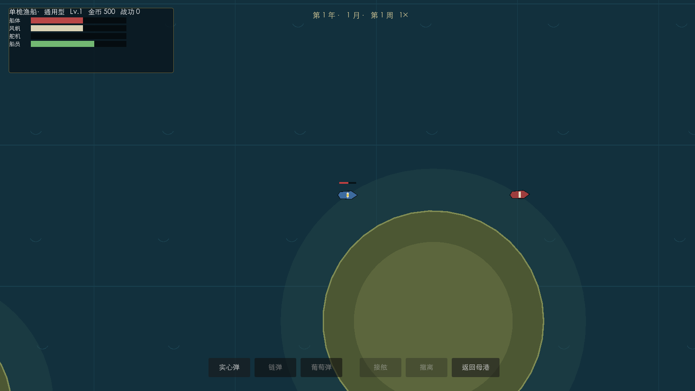
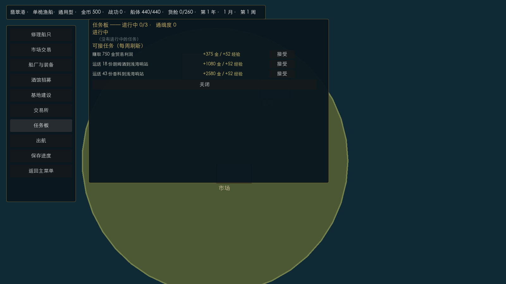
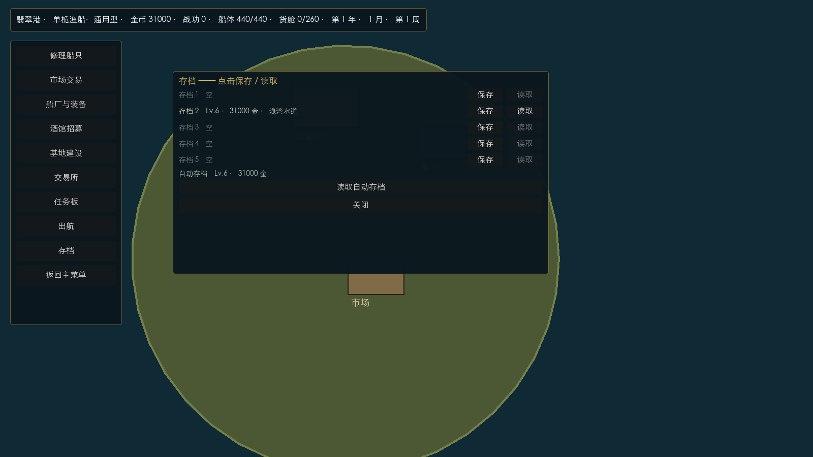
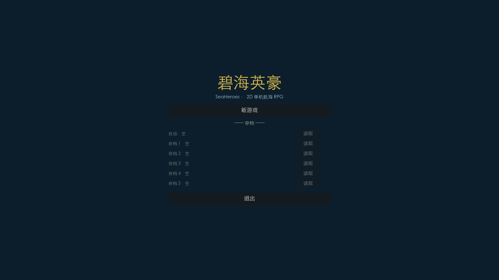

# 阶段四测试报告（世界内容）

| 项 | 内容 |
|---|---|
| 日期 | 2026-11-16 |
| 范围 | 10 张海图与关卡推进 · 18 个 Boss · 任务系统 · 悬赏与通缉 |
| 结论 | **通过**（自动化 264 项全绿：单元 65 + 集成 199） |
| 追加 | Boss 改为装备特异化（不做技能）· 补齐护航/采集任务 · 哨站简化为维修/交易/任务 · 存档位 UI |
| 设计依据 | `01-overall-design.md` §5；`02-systems-design.md` §4 / §9 / §10 |

---

## 1. 十张海图与关卡推进

| 图 | 海域 | 敌方等级 | 海盗主动 | 普通海盗/海怪 | Boss 海盗 | Boss 海怪 |
|---|---|---|---|---|---|---|
| 1 | 浅湾水道 | 1~3 | 否 | 4 / 2 | 「独眼」杰克 | 礁石巨蟹 |
| 2 | 珊瑚浅滩 | 3~6 | 否 | 6 / 3 | 「红胡」巴博萨 | 珊瑚海蛇 |
| 3 | 迷雾海峡 | 6~10 | **是** | 8 / 4 | 「幽灵」范德 | 迷雾水母主 |
| 4 | 商道外海 | 10~15 | **是** | 9 / 4 | 「剪径者」莫尔干 | 黑鳍鲨王 |
| 5 | 黑鲸海域 | 15~21 | **是** | 10 / 5 | 「铁钩」卡尔 | 黑鲸王 |
| 6 | 风暴角 | 21~28 | **是** | 11 / 5 | 「风暴」艾琳 | 雷暴海龙 |
| 7 | 骸骨礁群 | 28~36 | **是** | 12 / 6 | 「白骨」萨默斯 | 骸骨大王乌贼 |
| 8 | 深渊裂流 | 36~45 | **是** | 13 / 6 | 「深渊」戴维 | 深渊利维坦 |
| 9 | 王冠之海 | 45~60 | **是** | 14 / 7 | 「王冠」无名船长 | 九头蛇·涅柔斯 |

**实现要点**

- `MapDef` 10 张数据表（图 0 = 母港，图 1~9 为海域）
- 岛屿按 `island_seed` **确定性生成**（每图 4~6 座，避开出生点与航门），不手摆 10 套布局
- 敌人按地图配额生成，等级缩放 `1 + (图号−1) × 0.35`
- 3 级以上海盗进入 1200px 主动索敌
- **两道航门**：后退门（图 1 回母港，其余回上一图）、前进门（击破本图任一 Boss 后开启）
- 击破 Boss → 记录 `boss_defeated` + `cleared_maps` → 下一图航门解锁



---

## 2. 十八个 Boss

| 类型 | 数量 | 实现 |
|---|---|---|
| Boss 海盗 | 9 | 放大 1.7 倍的战舰，`hp_mult` 2.2~6.8、`damage_mult` 1.3~3.0 |
| Boss 海怪 | 9 | 放大 1.8 倍，躯体 900~8200、攻击 45~170、肢体 2~4 条 |

**三阶段机制**（两种 Boss 共用阈值）：

| 阶段 | 触发 | 强化 |
|---|---|---|
| 1 | 100%~66% | 基础 |
| 2 | ≤ 66% | 伤害 ×1.3，装填 ×0.9 |
| 3 | ≤ 33% | 伤害 ×1.6，装填 ×0.8 |

- 击败后**永久移除**（`is_boss_defeated`），不重复刷新
- 战功奖励 3~25 点，装备掉率 100%

---

## 3. 任务系统

| 类型 | 内容 | 进度来源 |
|---|---|---|
| 讨伐 | 击杀 N 个海盗 / 海怪 | 击杀事件 |
| 贸易 | 赚取 N 金贸易利润 | 市场卖出的毛利 |
| 运输 | 运送 N 份商品到浅湾哨站 | 哨站交付 |

- 每周刷新 3 个，同时最多进行 3 个
- 完成后自动发放金币 + 经验 + 战功，并滚动 `EventBus.ticker`
- 任务板在母港，显示进度 `当前 / 目标`



---

## 4. 悬赏与通缉

| 行为 | 通缉度变化 |
|---|---|
| 击沉海盗 / 海怪 | −2（Boss −5） |
| 击沉海军 | +15 |
| 劫掠商船 | +8 |

- 通缉度 ≥ 50 → 每 45 秒判定，最多同时在场上 2 艘**海军赏金猎人**（`navy_patrol`，按当前地图等级缩放）
- 赏金猎人一出现就锁定玩家
- 击沉后通缉度不再回涨，需自行通过打海盗或保释金降低

---

## 4.5 追加交付（按需求方第二轮反馈）

### 4.5.1 Boss 改为「装备特异化」，不做技能

| Boss | 独有装备 | 独有船员 |
|---|---|---|
| 「独眼」杰克 | 独眼罗盘旗（航速+4% 转向+6%） | 老罗盘手（瞭望 42） |
| 「红胡」巴博萨 | 红胡帆（航速+14%） | 红胡副官（大副 44） |
| 「幽灵」范德 | 幽灵舵轮（转向+22%） | 无声舵手（舵手 46） |
| 「剪径者」莫尔干 | 剪径者胸甲（装甲+60） | 剪径炮长（炮手 44） |
| 「铁钩」卡尔 | 铁钩船首像（接舷+26 转向+5%） | 铁钩打手（突击队长 48） |
| 「风暴」艾琳 | 风暴之帆（航速+19% 转向+4%） | 风暴望手（瞭望 48） |
| 「白骨」萨默斯 | 白骨甲板（装甲+85） | 白骨木匠（木匠 45） |
| 「深渊」戴维 | 深渊之旗（航速+8% 转向+10%） | 深渊引水人（操帆长 50） |
| 「王冠」无名船长 | 王冠遗物（航速+12% 转向+12%） | 王冠掌旗官（大副 50） |

- 装备稀有度 SSR~UR，击败后直接入库并播报
- 独有船员自动加入名册（UR，技能 42~50，不可重复获得）
- **海怪 Boss 不做特化**，只堆属性（按需求方要求）

### 4.5.2 任务补齐：护航与采集

| 类型 | 机制 |
|---|---|
| 护航 | 接单后海域生成一艘受护商船跟随玩家；抵达哨站即完成，商船被击沉则任务失败 |
| 采集 | 接单后海域生成 3 处沉船打捞点，靠近按 `E` 打捞 |

### 4.5.3 哨站简化为维修 / 交易 / 任务

按需求方要求**不做建造**，只保留三项：

- **维修**：按船体/帆/舵/船员缺失计价，受船坞等级减免
- **交易**：4 种商品的本地买卖
- **任务**：显示进行中任务进度，运输任务可当场交付

### 4.5.4 存档位 UI

- 主菜单直接列出 **6 个槽位**（自动 + 5 手动），显示等级 / 金币 / 所在海域
- 母港「存档」面板：逐槽保存 / 读取
- 进入母港自动写自动档





---

## 5. 自动化测试

| 套件 | 项数 | 结果 | 本阶段新增 |
|---|---|---|---|
| 单元 `tests/headless/run_all.gd` | 65 | 全过 | 0（阶段四均为系统级，走集成） |
| 集成 `tests/integration/run.tscn` | 199 | 全过 | +72 地图 / Boss / 任务 / 通缉 / 掉落 / 存档位 |

新增关键用例：

| 用例 | 期望 |
|---|---|
| 9 张海域数据载入、图 1/3/9 属性正确 | 通过 |
| 未通关时下一图锁闭 | 通过 |
| 击破 Boss 触发解锁、重复击杀不再触发 | 通过 |
| 海域场景按当前地图生成岛屿与敌人 | 图 3 生成 ≥8 个敌人、≥4 座岛 |
| Boss 刷新且 id 正确 | 通过 |
| 血量 60% → 阶段 2、30% → 阶段 3，火力提升 | 通过 |
| 击败 Boss 记入已击败并标记地图通关 | 通过 |
| 任务刷新 3 个、接受、越界拒绝 | 通过 |
| 讨伐任务进度累加并自动发奖（金币 + 战功） | 通过 |
| 贸易任务按利润累计 | 通过 |
| 通缉度：海盗 −2 / 海军 +15 / 商船 +8 | 通过 |
| 通缉度 ≥50 时海域刷出赏金猎人 | 通过 |
| 击败 Boss 掉落独有装备与 UR 船员 | 通过 |
| 护航抵达完成、商船沉没失败 | 通过 |
| 打捞点生成 3 处、靠近可采集 | 通过 |
| 存档位元数据（等级/金币/地图）可读 | 通过 |
| 哨站维修计价与执行 | 通过 |

---

## 6. 发现并修复的缺陷

| # | 现象 | 根因 | 修复 |
|---|---|---|---|
| 1 | 9 张地图全部加载失败 | 只写了 .tres，漏写 `map_def.gd` | 补上 Resource 类（这是第二次犯"只写数据不写类"的错） |
| 2 | `GameState` 解析失败，游戏起不来 | 误用 `StatsLib.xp_to_next`（该方法在 `CombatResolver`） | 改 `CRes.xp_to_next` |
| 3 | Boss 血量被放大到 40 倍 | Boss 同时吃 `hp_mult` 与按 tier 的等级缩放 | Boss 改用统一的地图缩放 `_map_scale()` |

---

## 7. 与设计的偏差

| 项 | 设计 | 实现 | 说明 |
|---|---|---|---|
| Boss 招牌技能 | 每个 Boss 独有技能 | **取消**，改为独有装备 + 独有船员 | 需求方判定：海盗 Boss 的差异应该体现在配置而非技能；海怪只堆属性 |
| 护送 / 采集任务 | 6 类任务 | **已补齐**：讨伐 / 贸易 / 运输 / 护航 / 采集 | — |
| 港口设施 | 每图 2~3 个完整港口 | 仅图 1 哨站，且只保留维修/交易/任务 | 需求方要求简化，不做建造 |
| 通缉度 >80 全图猎杀 | 更高强度 | 未单独做 | 现有编队已能体现压力 |

---

## 8. 阶段四完成后的状态

游戏已具备完整主干：

```
母港（建造/市场/船厂/酒馆/交易所/任务板）
   ↓ 出航
图 1 浅湾水道 ── 击破 Boss ──▶ 图 2 … ──▶ 图 9 王冠之海
   ↓ 途中：自动炮战 / 接舷俘获 / 战利品 / 赏金猎人
   ↓ 回港：修理 / 交易 / 换船 / 建造 / 交任务
```

**第一版可运行内容已齐备。** 明确留到后续版本的：

- Boss 进一步的特异性深化（独有技能、召唤、阶段演出）
- 其余 8 张图的港口设施
- 音乐与音效
- 美术资源替换（当前全部为程序化几何）
