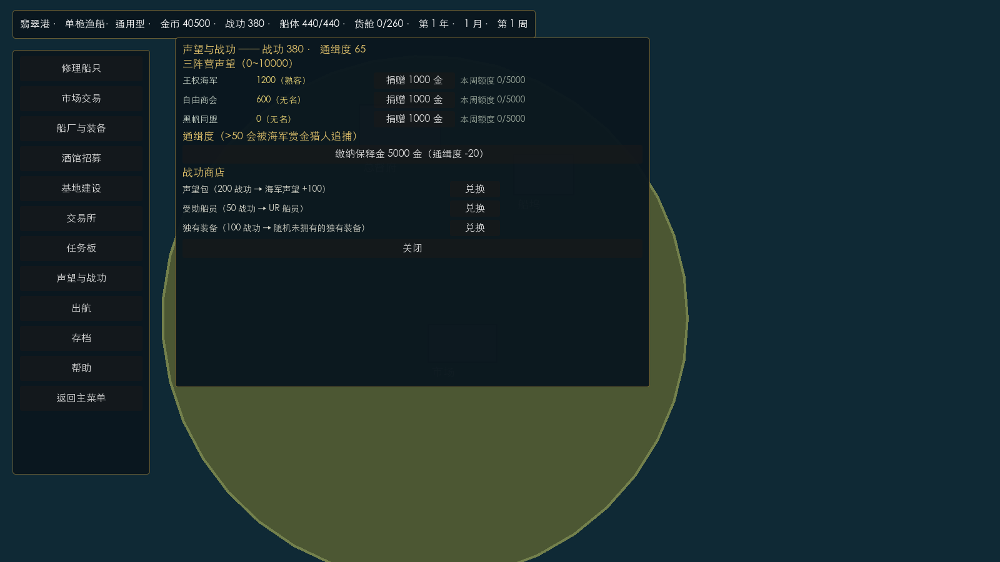
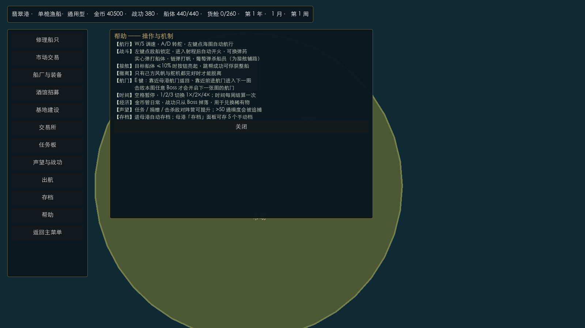

# 阶段五测试报告（系统收口）

| 项 | 内容 |
|---|---|
| 日期 | 2026-11-16 |
| 范围 | 声望三轴落地 · 战功消耗端 · 通缉保释 · 通关结算 · 帮助与引导 |
| 结论 | **通过**（自动化 305 项全绿：单元 65 + 集成 240） |
| 动机 | Demo 前的三个功能缺口：声望永远为 0（变体船买不到）、战功只进不出、打完图 9 无反馈 |

---

## 1. 声望三轴（原本只有字段，没有玩法）

### 1.1 三条获取途径

| 途径 | 数值 |
|---|---|
| **任务** | 任务带阵营，完成时该阵营 **+120** |
| **捐赠** | 1,000 金 = 10 声望，每阵营每周上限 5,000 金（50 声望） |
| **击杀** | 击沉海盗 → 海军 +3（Boss +8）、黑帆 −3；击沉海军 → 海军 −30、黑帆 +15；劫掠商船 → 商会 −40、黑帆 +15 |

### 1.2 等级与作用

| 声望 | 等级 | 作用 |
|---|---|---|
| 0~999 | 无名 | 基础服务 |
| 1,000~2,999 | 熟客 | 5% 折扣 |
| 3,000~5,999 | 盟友 | 解锁 IV~VI 级变体船 |
| 6,000~8,999 | 贵宾 | 解锁 VII~IX 级变体船 |
| 9,000~10,000 | 传奇 | 解锁 X 级变体船 |

> 这条链路打通后，**海军型 / 海盗型船体第一次真正可买**——之前声望恒为 0，船厂里那 20 个变体全是摆设。

---

## 2. 战功消耗端

战功此前只从 Boss 掉，没有任何用途。现在接入商店：

| 商品 | 价格 | 内容 |
|---|---|---|
| 声望包 | 200 战功 | 指定阵营 +100 声望 |
| 受勋船员 | 50 战功 | UR 船员（技能 40~50，随机岗位） |
| 独有装备 | 100 战功 | 随机一件尚未拥有的 Boss 独有装备 |

> 这条设计让"打 Boss 攒战功"与"声望解锁变体船"两条线互相咬合：战功能换声望，声望能买船。

---

## 3. 通缉管理

- **保释金**：5,000 金 → 通缉度 −20（母港声望面板）
- **自然衰减**：每周结算时通缉度向 0 靠拢 2 点
- 通缉度 ≥50 时海军赏金猎人继续按原规则搜捕

---

## 4. 通关结算与统计

- 新增统计：击杀总数、Boss 击杀数、通关标记（全部随存档保存）
- 清空图 9 后触发通关：海域里播报「★ 通关！」，回到母港弹出结算面板（击杀数 / Boss 数 / 金币 / 战功）

---

## 5. 帮助与引导

母港新增「帮助」面板，覆盖 11 条核心说明：航行、战斗、弹药差异、接舷、撤离、航门、时间、经济、声望、存档。

---

## 6. 自动化测试

| 套件 | 项数 | 结果 | 本阶段新增 |
|---|---|---|---|
| 单元 | 65 | 全过 | 0 |
| 集成 | 240 | 全过 | +41 声望 / 战功 / 通关 |

新增用例摘录：

| 用例 | 期望 |
|---|---|
| 声望累加与等级判定（1200 → 熟客） | 通过 |
| 声望不会为负 | 通过 |
| 捐赠 1000 金 → 声望 +10、扣金正确 | 通过 |
| 周捐赠额度封顶 5000、用尽后拒绝 | 通过 |
| 每周重置捐赠额度 | 通过 |
| 击沉海盗 海军 +3 / 击沉海军 黑帆 +15 | 通过 |
| 保释金 5000 → 通缉度 −20 | 通过 |
| 每周自然衰减 −2 | 通过 |
| 任务完成给对应阵营 +120 | 通过 |
| 战功不足时拒绝兑换 | 通过 |
| 三种战功商品各自扣费与发放 | 通过 |
| 清完图 9 触发通关且只触发一次 | 通过 |
| 击杀 / Boss / 通关标记随存档保存 | 通过 |

---

## 7. 发现并修复的问题

| # | 现象 | 根因 | 修复 |
|---|---|---|---|
| 1 | 声望存读档断言失败 | 测试里先打了两个敌人（+3、+8），断言却写死 0 | 改为记录存档前的真实值再比对 |

---

## 8. 至此还缺什么（Demo 交付清单）

| 项 | 状态 |
|---|---|
| 声望 / 战功 / 通缉 / 通关 / 帮助 | ✅ 本阶段完成 |
| **二轮平衡**（首轮后已调整，需再跑一次全流程） | 待做 |
| **完整回归与稳定性压测**（长时间运行、反复进出场景） | 待做 |
| **Demo 交付文档**（玩法说明、已知问题、已知限制） | 待做 |
| Boss 特异性深化、其余 8 图港口、音效、美术替换 | 明确排到后续版本 |
