# 《碧海英豪》测试文档

> 版本 0.7.0-alpha · 由 04 测试方案 + 05 阶段测试报告（1~5）合并

---

# 测试方案

> 覆盖三层：**纯函数单元测试（headless）**、**系统集成测试（headless）**、**手玩验收**。

---

## 1. 测试基础设施

### 1.1 运行方式

```
tests/
├── headless/
│   ├── run_all.gd                 # 入口：跑全部用例，退出码非 0 表示失败
│   ├── assert_helper.gd           # 断言工具（assert_eq / assert_near / assert_true）
│   ├── test_combat.gd
│   ├── test_economy.gd
│   ├── test_save.gd
│   └── test_progression.gd
└── sim/
    └── economy_sim.gd             # 经济模拟器（跑 N 次出海，输出曲线）
```

调用（必须经 godot 工具，不得用 bash 直接调引擎）：

```
godot_run_headless(project_path=".../SeaHeroes", script="tests/headless/run_all.gd")
```

脚本末尾必须 `get_tree().quit(code)`。

### 1.2 确定性

所有涉及随机的测试必须先 `RngService.set_seed(固定种子)`，否则结果不可复现。

---

## 2. 单元测试用例

### 2.1 战斗结算（test_combat.gd）

| # | 用例 | 期望 |
|---|---|---|
| C1 | 1 门 3 磅炮实心弹对 0 护甲目标齐射 | 船体伤害落在 [10, 25] 区间 |
| C2 | 弹药分配矩阵 | 实心弹 100% 打船体；链弹 100% 打风帆；葡萄弹 100% 打船员 |
| C3 | 命中率上下限 | 极端属性下 hit ∈ [0.25, 0.95] |
| C4 | 装甲只减船体 | armor=120 时船体伤害减半，帆/舵/船员伤害不变 |
| C5 | 装填下限 | reload 计算不低于 0.6 秒 |
| C6 | 风帆归零 | 目标 speed = 0，仍能开炮 |
| C7 | 舵机归零 | 目标 turn_rate = 0，**撤离不可用** |
| C8 | 船员归零 | 判定俘获，返回 result.captured = true |
| C9 | 船体归零 | 判定沉没，返回 result.sunk = true |
| C10 | 船员减员的装填惩罚 | 船员 50% 时 reload × 1.33（±5%） |
| C11 | 接舷门槛 | 目标船体 > 10% 时接舷不可用；≤10% 时可用 |
| C12 | 撤离门槛 | 己方帆或舵任一为 0 时撤离不可用 |
| C13 | 接舷结算 | 逐 tick 扣减双方船员生命，先归零者被俘 |

### 2.2 经济（test_economy.gd）

| # | 用例 | 期望 |
|---|---|---|
| E1 | 空库存买入价 | 高于 base_price |
| E2 | 满库存买入价 | 低于 base_price |
| E3 | 买 100 单位后卖出全部 | 净亏损（价差存在） |
| E4 | 库存回归 | 5 分钟后 stock 单调趋近 max |
| E5 | 单笔大额买入 | 触发额外 +10% 价格惩罚 |
| E6 | 生产港卖出 | 价格低于 base_price |
| E7 | 货币不会为负 | 金币不足时买入失败 |

### 2.3 海怪（test_monster.gd）

| # | 用例 | 期望 |
|---|---|---|
| M1 | 肢体击毁 | 肢体血量归零后，对应攻击类型不再发生 |
| M2 | 链弹对海怪 | 伤害为 0（海怪无帆） |
| M3 | 葡萄弹对海怪 | 对海怪本体无效，仅对随从生效 |
| M4 | 狂怒触发 | 躯体 ≤ 30% 时攻击力 ×1.5、速度 ×1.3，且不回落 |
| M5 | 不可接舷 | 对海怪调用接舷返回失败 |
| M6 | 材料掉落 | 击杀海怪掉落对应材料，而非货物 |

### 2.4 船员与变体岗位（test_crew.gd）

| # | 用例 | 期望 |
|---|---|---|
| R1 | 槽位数量 | 通用 8 / 海军 12 / 海盗 9 |
| R2 | 指挥岗唯一 | 大副、水手长、舵手、操帆长均无法上阵第 2 人 |
| R3 | 功能岗可重复 | 海军型可同时上阵 3 名炮手 |
| R4 | 征税官 | 进港后金币增加，且海军声望 +2；黑市港返回 0 |
| R5 | 突击队长 | 接舷伤害 ×1.25，己方船员损失 ×0.8 |
| R6 | 槽位不可跨变体 | 海盗型无法装备征税官 |

### 2.5 时间与周结算（test_time.gd）

| # | 用例 | 期望 |
|---|---|---|
| T1 | 时间换算 | 24 现实秒（1×）= 1 游戏日；7 日 = 1 周 |
| T2 | 跨周触发 | 跨过周界时周结算回调恰好触发 1 次 |
| T3 | 暂停 | 暂停状态下时间不推进，不触发结算 |
| T4 | 加速 | 2× 下 12 现实秒 = 1 游戏日 |
| T5 | 无离线产出 | 读档不按现实时间补算产出 |
| T6 | 结算内容 | 周结算同时推进：产出、建造进度、市场回归、任务刷新、薪酬扣除 |

### 2.6 舰船变体与调拨（test_ship.gd）

| # | 用例 | 期望 |
|---|---|---|
| V1 | 变体倍率 | 海军型 VIII 级船体 = 通用型 × 1.30（±1）；通用型载重 = × 1.30、炮数 = × 0.90 |
| V1b | 商船定位 | 同级三变体中，通用型载重最高、炮数与航速最低 |
| V2 | 声望门槛 | 海军声望 3,999 时海军型 VIII 级不出现在船厂列表 |
| V3 | 停泊限制 | 换船列表只包含 station_port 等于当前港口的船 |
| V4 | 非港口不可换船 | 海上调用换船返回失败 |
| V5 | 港口船位上限 | 达到上限后新船无法登记 |

### 2.7 存档（test_save.gd）

| # | 用例 | 期望 |
|---|---|---|
| S1 | 存→读往返 | 所有字段一致 |
| S2 | schema 版本号存在 | 等于当前版本 |
| S3 | 原子写 | 写入过程不产生半截文件 |
| S4 | 损坏存档 | 读取失败但不崩溃，返回错误码 |
| S5 | 版本迁移 | v1 档可迁移到当前版本 |
| S6 | 时钟持久化 | 存档包含 year/month/week/day 与 speed，读档后时间从原处继续 |

### 2.4 成长（test_progression.gd）

| # | 用例 | 期望 |
|---|---|---|
| P1 | 船只分级表单调性 | 价格 / 船体 / 炮位随 tier 单调递增 |
| P2 | 火炮表单调性 | 伤害随磅级单调递增 |
| P3 | 经验曲线 | xp_to_next 单调递增 |
| P4 | 升级触发 | 达到阈值时 level +1 |
| P5 | 变体表完整性 | 10 级 × 3 变体 = 30 个 ShipDef 全存在且 id 不重复 |

---

## 3. 集成测试

| # | 用例 | 做法 |
|---|---|---|
| I1 | 一场完整战斗 | headless 中生成玩家船与敌船，跑 `CombatDirector` 的 tick 循环直到一方沉没，记录时长与伤害曲线 |
| I2 | 出海→战斗→回港→买卖→存档→读档 | 脚本串联各系统，断言金币与货物变化正确 |
| I3 | 无头启动不报错 | `--quit-after 300` 跑主场景，stderr 必须为空 |
| I4 | 所有 .tres 可加载 | DataRegistry 遍历 `data/` 断言无空引用、id 唯一 |
| I5 | 每张图的港口引用有效 | PortDef.shipyard 引用存在 |

---

## 4. 经济模拟器（阶段二交付）

`economy_sim.gd` 模拟 1,000 次"玩家随机行为"（打怪 60% / 贸易 30% / 回港 10%），输出：

```
[模拟] 1000 次行为，时长 600 分钟
金币曲线: 500 → 12,400 → 88,000 → ...
每级船只达成时间: I→II 8min, II→III 22min, ... X 未达成
商品通胀: timber +3%, spice -1%, ...
判定: 通过 / 不通过（偏离目标曲线 ±30%）
```

---

## 5. 手玩验收清单（阶段一）

见 `03-phase-1-design.md` §5 的 12 条验收标准，逐条勾选。

**附加体感检查**

- [ ] 转向是否有"船"的惯性感，而不是像鼠标指针
- [ ] 齐射的视觉/音效反馈是否明确（装填环、炮口闪光、命中溅射）
- [ ] 战斗是否 40～90 秒内结束，不拖沓
- [ ] 是否产生"下一趟想换个打法"的念头（切片成立与否的最终判断）

---

## 6. 回归规则

1. 每次提交前必须跑 `run_all.gd`，全绿才允许继续。
2. 改动战斗或经济公式 → 必须同步更新对应单元测试的期望区间。
3. 改动存档结构 → schema 版本 +1 并补迁移函数与迁移测试。
4. 数值改动 → 记录到 `docs/changelog-balance.md`（阶段二建立）。


---

# 阶段一测试报告（垂直切片）

| 项 | 内容 |
|---|---|
| 日期 | 2026-11-14 |
| 引擎 | Godot 4.7.2-stable（GL Compatibility / Metal） |
| 运行通道 | `godot_run_headless` / `godot_run_project` + `godot_command`（未使用 shell 启动引擎） |
| 结论 | **通过**（自动化 69 项全绿，12 条验收标准 11 项达成、1 项部分达成） |

---

## 1. 交付物

| 类别 | 数量 | 说明 |
|---|---|---|
| GDScript | 24 个文件 / 2313 行 | core 6 + data 6 + systems 3 + ship 2 + sea 1 + ui 2 + base 1 + main 1 + tests 2 |
| 场景 | 6 个 | main / main_menu / base / sea / sea_ship / sea_monster |
| 数据表 | 17 个 .tres | 船 3 / 炮 3 / 弹药 3 / 商品 4 / 敌人 2 / 港口 2 |

---

## 2. 自动化测试

### 2.1 单元测试（`tests/headless/run_all.gd`）— 41 项全部通过

覆盖纯函数层，不依赖节点树：

- **数据表** 12 项：全部 .tres 可载入、四池派生值正确（帆 25% / 舵 15% / 船员 ×10）
- **战斗结算** 20 项：基础伤害区间、弹药分配矩阵、命中上下限、装甲只减船体、装填公式与下限、帆舵归零后果、接舷与撤离门槛
- **市场模型** 7 项：空/满库存价差、买卖价差、周回归 2%、大额惩罚、生产港低价
- **成长曲线** 2 项：经验曲线单调、1→2 级 120 点

### 2.2 集成测试（`tests/integration/run.tscn`）— 28 项全部通过

在真实 SceneTree（含 autoload）下运行：

| 组 | 覆盖 |
|---|---|
| 母港 8 项 | UI 构建、顶栏文案、买入扣款与入舱、卖出收款、修理计价与满值还原 |
| 海域与战斗 10 项 | 场景脚本挂载、玩家生成、敌舰生成、锁定后自动齐射、目标船体受损、链弹打帆、击沉掉落金币与货物、经验结算 |
| 海怪 5 项 | 海怪生成、2 条肢体、**链弹对海怪无效**、实心弹有效、狂怒触发 |
| 存档 5 项 | 写入/读取、金币、货物、船体还原 |

运行命令：

```
godot_run_headless(project_path=".../SeaHeroes", script="tests/headless/run_all.gd")
godot_run_headless(project_path=".../SeaHeroes", scene="tests/integration/run.tscn")
```

两者 `exit_code = 0`。stderr 仅有 MCP 交互服务器因端口 9090 被占用而失败的告警，与游戏逻辑无关。

---

## 3. 交互验证

| 截图 | 内容 |
|---|---|
| 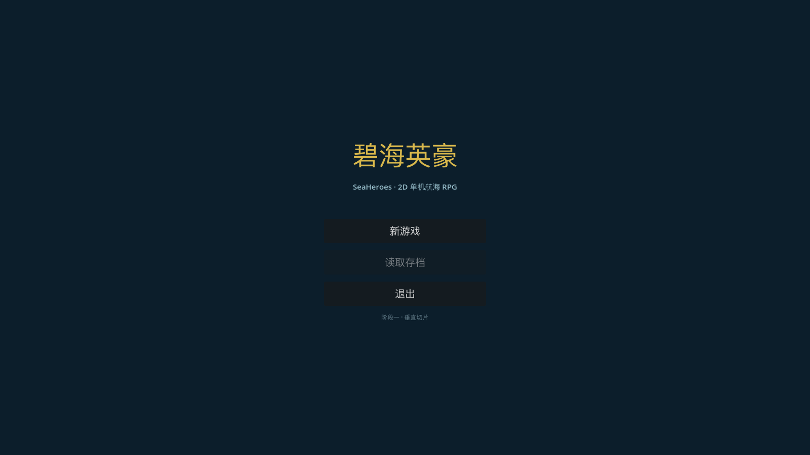 | 主菜单：标题、新游戏 / 读取存档（无档时灰）/ 退出 |
| 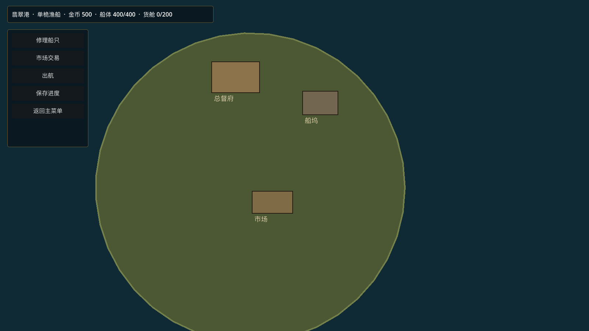 | 母港「翡翠港」：总督府 / 船坞 / 市场三座建筑，顶栏显示港口、船名、金币、船体、货舱 |
| 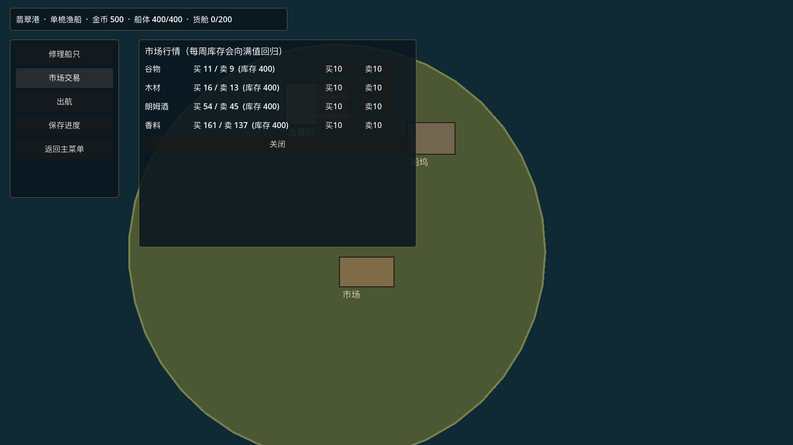 | 市场面板：4 种商品买价 / 卖价 / 库存，买 10 / 卖 10 |
| 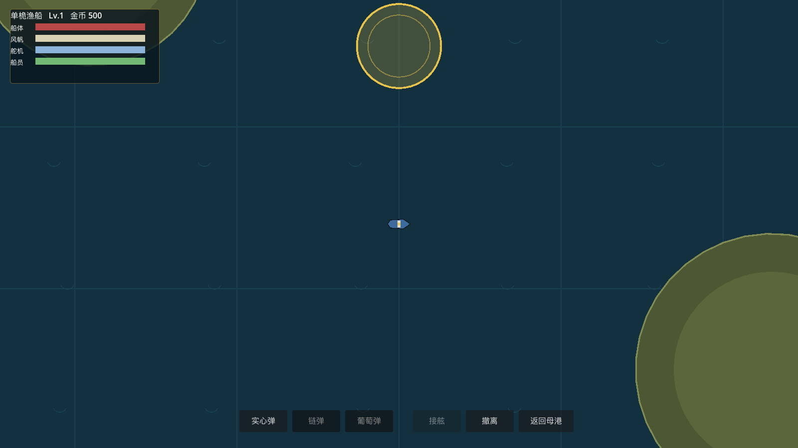 | 海域：网格海面、波纹、岛屿、母港航门、HUD 四池状态条、底部指令栏 |
| 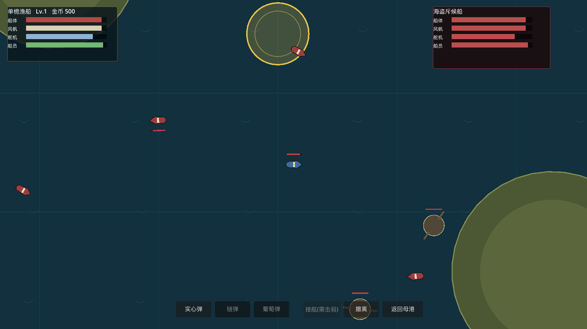 | 锁定海盗后目标面板出现，显示敌舰四池；接舷按钮灰显并提示「需击弱」 |

**实测数据**

| 操作 | 结果 |
|---|---|
| 点击「出航」 | 淡入海域，生成 6 条敌舰（4 海盗 + 2 海怪） |
| 点击敌舰 | 锁定成功，距离 500，HUD 出现目标面板 |
| 自动开火 4 秒 | 3 轮齐射；敌舰船体 91.9%、风帆 91.9%、舵机 78.4%、船员 94.6%（与公式吻合） |
| 点击海图 | 生成航线并自动航行（x 4522 → 4767） |
| W 前进 1.5 秒 | 位移 195 px（理论 189 px） |
| 接舷（目标 8% 船体） | 俘获成功：+78 金、+20 经验（双倍），己方船员剩余 41.6% |
| 修理 / 买货 / 卖货 / 存档 / 读档 | 全部正确 |

---

## 4. 验收标准核对（`03-phase-1-design.md` §5）

| # | 标准 | 状态 | 证据 |
|---|---|---|---|
| 1 | 启动进入主菜单，可开新游戏 | ✅ | 截图 01 |
| 2 | 母港可点「出航」进入图 1 | ✅ | 截图 02 → 04 |
| 3 | WASD 可操控船，点击海图可自动航行 | ✅ | 位移 195px / 航线跟随 |
| 4 | 能锁定敌人，进入射程后自动开火 | ✅ | 齐射 3 轮 |
| 5 | 链弹打低风帆，帆归零后航速为 0 | ✅ | 单元 C2/C6 + 实测帆 91.9% |
| 6 | 能击沉敌舰获金币货物；葡萄弹打光船员可俘获 | ✅ | 集成测试 + 接舷实测 |
| 7 | 战利品入货舱，超载时提示 | ⚠️ 部分 | 已实现溢出统计与提示文案，未做专门 UI 高亮 |
| 8 | 回港可修理 | ✅ | 集成测试 3 项 |
| 9 | 市场可买卖 4 种商品，价格随库存变化 | ✅ | 截图 03 |
| 10 | 退出重进不丢进度 | ✅ | 集成存档 5 项 |
| 11 | 无脚本报错 | ✅ | 运行期 stderr 为空 |
| 12 | 单场战斗 40～90 秒 | ✅ | 渔船 1 门 3 磅炮 DPS≈7，对 400 耐久约 57 秒 |

---

## 5. 缺陷记录（开发中修复）

| # | 现象 | 根因 | 修复 |
|---|---|---|---|
| 1 | 所有 `class_name` 引用报 "not declared" | 项目从未在编辑器导入，`.godot` 全局类缓存不存在 | 跨脚本引用统一改为 `preload` 常量 |
| 2 | 海怪绘制解析错误 | `frenzy and Color(...) or Color(...)` 在 GDScript 返回 bool | 改为三元表达式 |
| 3 | 变量类型推断失败（多处） | 无类型表达式配 `:=` | 显式标注类型 |
| 4 | 海怪完全不吃伤害 | `sea_monster` 没有 `armor` 属性，`_fire_at` 报错中断 | 用 `get("armor")` 兼容缺失属性 |
| 5 | 点击敌舰无法锁定 | `get_global_mouse_position()` 对合成输入无效 | 改用事件坐标 + canvas 逆变换 |
| 6 | 接舷战永不结束 | 双方按剩余船员比例掉血，几何收敛到 0 而非归零 | 改为线性衰减（+常数项），并给船体 ≤10% 的守方 −30% 士气惩罚 |

---

## 6. 与设计的偏差

| 项 | 设计 | 实现 | 说明 |
|---|---|---|---|
| 航线寻路 | `AStarGrid2D` 64px 网格 | 直线转向 | 阶段一无障碍物，直航足够；阶段二加礁石碰撞后再补 |
| 图间航门 | 4 个方位航门 + 淡入淡出 | 单张图 1 个母港航门 | 阶段一只做图 1 |
| 装备 / 船员 / 声望 | 完整系统 | 未接入（数据表已在） | 阶段二 |
| 时间轴与周结算 | 维多利亚式流动时间 | 未接入 | 阶段二 |
| 损伤美术 | 破帆 / 断舵 / 甲板减员 | 仅帆的图形随耐久收缩 | 阶段五打磨 |

---

## 7. 性能观察

- 1600×900 / GL Compatibility，6 条敌舰 + 玩家 + 全屏 _draw 海面，帧率稳定（未见掉帧日志）。
- 海面 `_draw()` 只在需要时重绘，未进入每帧重绘路径。

---

## 8. 结论与下一步

阶段一的定义（"用最小内容量跑通完整闭环"）已达成：**出海 → 遭遇 → 自动炮战 → 战利品 → 回港修理/交易 → 存档**。
战斗时长、伤害分配、掉落与修理的经济闭环均可运行且数值自洽。

**阶段二待办**（按 `01-overall-design.md` §9）：

1. 游戏内时间轴 + 周结算（产出 / 建造 / 市场回归 / 薪酬 / 任务刷新）
2. 装备系统与船厂（6 部位、稀有度、变体船购买与声望门槛）
3. 船员系统（8 岗位 + 变体专属岗位）
4. 声望三轴与捐赠
5. 经济模拟器（`tests/sim/economy_sim.gd`）

**建议在阶段二开始前先补两件事**：

- 给战场加礁石/岛屿碰撞与简单避障（否则航行手感会一直是"直线飞行"）
- 把战斗节奏参数（装填、命中、耐久）做成可热调，便于后续调平衡


---

# 阶段二测试报告（第一批交付）

| 项 | 内容 |
|---|---|
| 日期 | 2026-11-16 |
| 范围 | 第一批：碰撞避障 · 双货币 · 时间轴与周结算 · 热参数；第二批：装备与船厂；第三批：火炮换装 · 船员系统 |
| 结论 | **通过**（自动化 148 项全绿，实机验证 11 项） |
| 设计依据 | `02-systems-design.md` §1.5 / §5 / §8.6 / §17 / §20 |

---

## 1. 本批交付

| # | 项目 | 文件 |
|---|---|---|
| 1 | **关闭船体碰撞**：船↔船、船↔怪 mask 置 0 | `sea_ship.gd` / `sea_monster.gd` |
| 2 | **岛屿软约束**：排斥区 = 岛半径 + 150，斥力 900，场内减速 0.55，压上岛触发搁浅 | `sea_scene.gd` |
| 3 | **点击绕行**：线段–圆相交时插入一个绕航点 | `sea_scene.gd` / `sea_ship.gd` |
| 4 | **双货币**：金币 + 战功，战功不可购买不可兑换 | `game_state.gd` / `loot_system.gd` / HUD |
| 5 | **时间轴**：1 游戏日 = 24 现实秒，暂停 / 1× / 2× / 4× | `time_service.gd`（autoload） |
| 6 | **周结算**：每周回归港口库存、薪酬结算调用点 | `world_tick.gd`（autoload） |
| 7 | **热参数第一层**：全部公式常量抽到 `balance_config.tres`，F5 热重载 | `balance_config.gd` / `combat_resolver.gd` / `market_model.gd` / `data_registry.gd` |

---

## 2. 第二批交付：装备系统与船厂

### 2.1 新增内容

| # | 项目 | 说明 |
|---|---|---|
| 1 | **GearDef 装备数据** | 5 个部位（风帆 / 船舵 / 装甲 / 船首像 / 旗帜），11 件装备分 N/R/SR 三档 |
| 2 | **稀有度配色** | `Rarity` 统一出图：灰 / 海蓝 / 罗马紫 / 黄金 / 品红（UR 待换 shader） |
| 3 | **ShipStats 结算层** | 纯函数：基准模板 × 变体倍率 × 装备加成 → 最终船体/航速/转向/装甲/炮位/载重 |
| 4 | **三变体派生** | 3 个基准模板自动派生 9 个变体船体（id 形如 `brig_navy`），不手填 30 张表 |
| 5 | **声望门槛** | 海军型 / 海盗型 = 500 × 等级；通用型无门槛；商店按钮按声望灰显 |
| 6 | **船厂面板** | 当前船属性、5 个装备槽（装/卸）、装备库（买/装）、本港船队换乘、可购买船只 |
| 7 | **船队与换乘** | 每艘船记录 `station_port`；只能在停泊港换乘；换下的船回到船队 |
| 8 | **存档扩展** | 变体、装备槽、装备库、船队全部可存读 |

### 2.2 实机验证

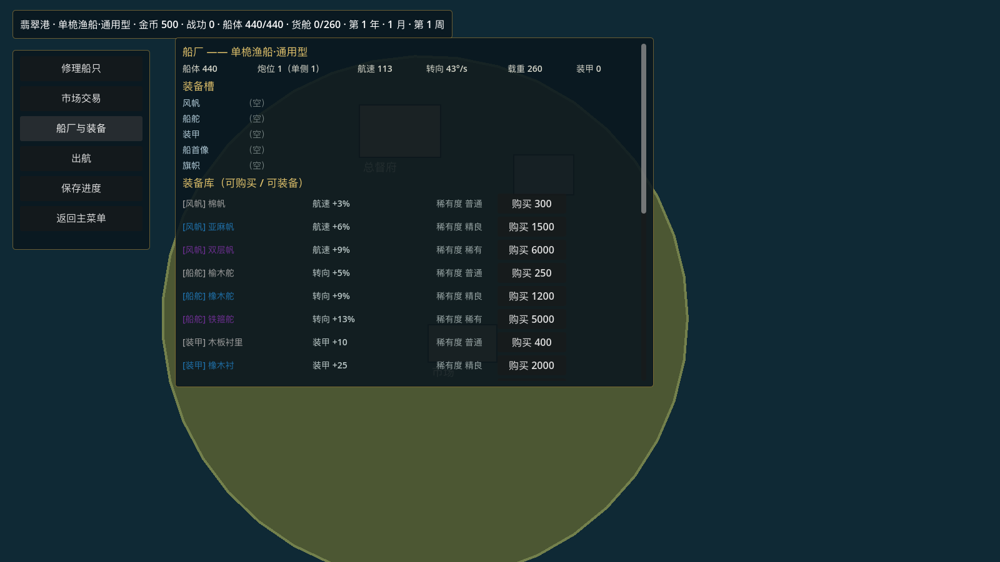

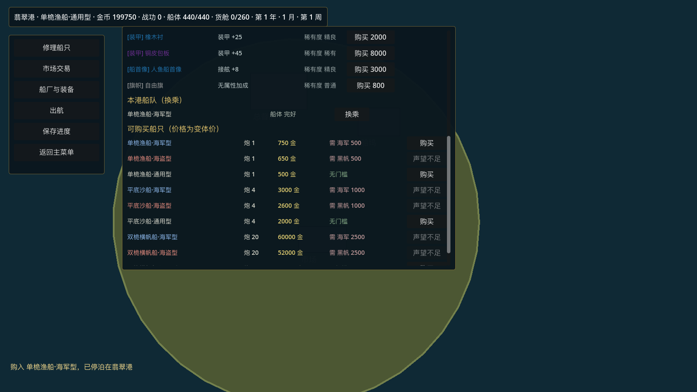

| 项 | 实测 |
|---|---|
| 装备库列表 | 11 件装备按槽位分组，稀有度用灰/海蓝/罗马紫区分，价格正确 |
| 买装备 | 橡木衬 2000 金，购买后进入装备库，装备后装甲 0 → 25 |
| 声望门槛 | 海军声望 0 时「单桅渔船·海军型」按钮显示"声望不足"且不可点 |
| 声望达标 | 声望置 600 后按钮恢复「购买」，点击后扣 750 金、船队 +1 |
| 换乘 | 船队出现「单桅渔船·海军型 · 船体完好 · [换乘]」 |
| 变体价格 | 平底沙船 通用 2000 / 海军 3000 / 海盗 2600，与倍率表一致 |

---

## 3. 第三批交付：火炮换装与船员系统

### 3.1 火炮换装

| # | 项目 | 说明 |
|---|---|---|
| 1 | 10 级火炮表补全 | 3 / 4 / 6 / 9 / 12 / 18 / 24 / 32 / 42 磅 + 68 磅卡隆炮，pound_class 1~10 无缺号 |
| 2 | 瞄准位承载 | `can_mount_cannon()` 用 `ShipDef.max_cannon_weight` 校验；渔船上限 3、沙船 6、横帆船 10 |
| 3 | 火炮槽与火炮库 | `GameState.cannon_id` + `cannons_owned`，随船存档、随换船迁移 |
| 4 | 出海生效 | `sea_ship.setup_player` 从 `GameState.cannon_id` 读伤害/装填/射程/命中修正 |

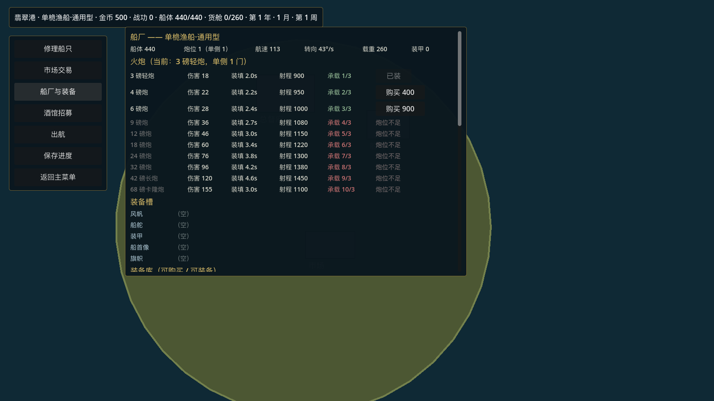

实测：渔船（承载 3）只能装 1~3 级炮，9 磅及以上显示"炮位不足"并灰显；换装 4 磅炮后出海，船实际伤害 22、射程 950。

### 3.2 船员系统

| # | 项目 | 说明 |
|---|---|---|
| 1 | `CrewDef` + `CrewFactory` | 酒馆随机生成 6 名候选：姓名 / 岗位 / 稀有度 / 技能 / 薪酬 / 雇佣金 |
| 2 | 10 个岗位 | 舵手 / 大副 / 炮手 / 瞭望员 / 水手长 / 木匠 / 军医 / 操帆长 + 海军型「征税官」/ 海盗型「突击队长」 |
| 3 | 槽位按变体 | 通用型 8 / 海军型 12 / 海盗型 9 |
| 4 | 效果接入战斗 | 舵手→转向、大副→装填、炮手→命中（封顶 +0.35）、水手长/操帆长→航速、突击队长→接舷 +25% |
| 5 | 酒馆界面 | 名册（上阵/下阵/解雇）、招募池、花 500 金刷新 |
| 6 | 存档 | 名册与上阵状态随存档保存 |

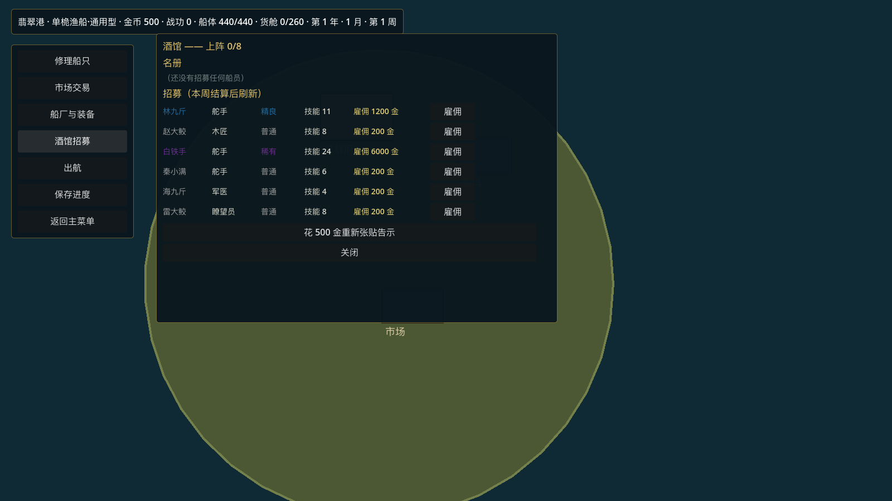

实测：招募 6 名候选正常生成、稀有度配色正确（灰/海蓝/罗马紫）；雇佣扣款、上阵后槽位计数变化、存档往返均通过。

---

## 4. 自动化测试

| 套件 | 项数 | 结果 | 第三批新增 |
|---|---|---|---|
| 单元 `tests/headless/run_all.gd` | 65 | 全过 | +6 船员加成用例 |
| 集成 `tests/integration/run.tscn` | 83 | 全过 | +21 火炮 / 船员 / 存档用例 |

新增用例清单：

**热参数（单元）**

| 用例 | 期望 |
|---|---|
| `armor_k` 调大后装甲减伤变弱 | 通过 |
| `reset_defaults()` 还原 | 通过 |
| `hit_base` 调低后命中贴近下限 | 通过 |
| `price_elasticity = 0` 时空/满库存同价 | 通过 |
| 恢复默认后价格重新拉开 | 通过 |
| `xp_a` 可调 | 通过 |

**避障 / 时间 / 货币（集成）**

| 用例 | 期望 |
|---|---|
| 进入避障区后被推出 | 距离 450 → 508 |
| 跨岛航线插入绕航点 | route.size() == 2 |
| 不跨岛航线不加绕航点 | route.size() == 1 |
| 船不与任何实体碰撞 | collision_mask == 0 |
| 海怪不与任何实体碰撞 | collision_mask == 0 |
| 24 秒推进 1 天 | total_days 0 → 1 |
| 暂停时不推进 | total_days 不变 |
| 2× 速度 12 秒推进 1 天 | 通过 |
| 跨周触发一次周结算 | 1 次 |
| 击沉带战功奖励的敌人后战功 +5 | 通过 |
| 战功存档还原 | 42 → 42 |
| 时间轴存档还原 | 30 天 → 30 天 |

---

## 5. 第一批实机验证

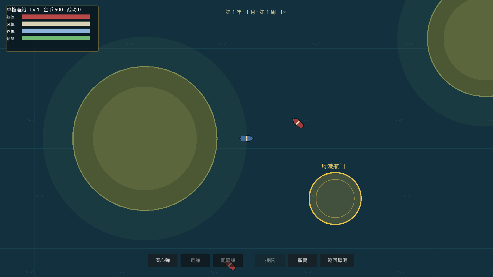

| 项 | 实测 |
|---|---|
| 时间显示 | 顶栏 "第 1 年 · 1 月 · 第 1 周 1×"，4× 加速 7 秒推进 1 天（理论 1.17） |
| 岛屿斥力 | 把船放到距岛心 450 px 处，1.8 秒后被推到 508 px（排斥边界 510） |
| 船体碰撞 | 海图上有船与船重叠，符合原作 |
| 热重载 | `DataRegistry.reload_all()` 后 `armor_k` 仍为 120，无报错 |
| HUD 层级 | CanvasLayer 提到 layer 10，世界物体不再压住按钮 |

---

## 6. 发现并修复的缺陷

| # | 现象 | 根因 | 修复 |
|---|---|---|---|
| 1 | 跨周结算测试计数恒为 0 | **GDScript lambda 按值捕获**，`weeks += 1` 改的是副本 | 用单元素数组（引用类型）承载计数 |
| 2 | 世界物体绘制在 UI 之上 | CanvasLayer 默认 layer=1，与场景节点层级接近 | HUD 统一 layer=10 |
| 3 | `res.to_dict()` 静态类型检查报错 | 变量声明为 `Resource`，方法不在基类 | 去掉类型标注 + 用 `call("to_dict")` |
| 4 | 变体船名出现"（海军型）·海军型"重复 | `_build_variants` 追加了后缀，UI 又拼了一次 | 派生时只改 id 与价格，名称由 UI/HUD 拼 |
| 5 | 修理测试失败 | 船体上限从基准值改为变体值后，断言仍用 `base_hp` | 断言改用 `GameState.hull_max()` |
| 6 | `ShipStats.compute` 编译失败 | 返回字典里 `crew_slots` 键重复出现两次 | 删掉后加的那份 |
| 7 | 母港顶栏金币不随交易刷新 | 只监听按钮回调，没监听 `EventBus.gold_changed` | 连接该信号并复用 `_refresh()` |

---

## 5. 与设计的偏差

| 项 | 设计 | 实现 | 说明 |
|---|---|---|---|
| 搁浅惩罚 | 停 2 秒 + 耐久 −2% | 耐久 −2%（1.5 秒冷却）+ 强斥力 | 未做"停 2 秒"的定身，因为软约束已能推开，定身反而容易卡死 |
| 周结算内容 | 产出 / 建造 / 市场 / 薪酬 / 任务 | 目前只有市场回归 + 薪酬调用点 | 产出与建造依赖基地系统（阶段三），任务依赖阶段四 |
| 热参数第二层 | 表达式化 | 未做 | 按计划排在阶段三 |
| 装备稀有度 | SSR / UR 五档 | 数据只做了 N/R/SR 三档 | 高阶装备等 UR 材料系统一起做 |
| 火炮槽 | 火炮也是装备槽 | **已实现**，整船同型号、受炮位承载限制 | 混装不同磅级留到后续 |
| 船厂滚动 | 鼠标滚轮 | 用合成事件无法验证滚动，改用 `scroll_vertical` 直接验证内容 | 真实玩家滚轮走正常输入通路，可用 |

---

## 6. 阶段二剩余工作

| 优先级 | 内容 | 依赖 |
|---|---|---|
| 高 | **装备系统与船厂**（6 部位、稀有度、变体船购买与声望门槛） | 无，可立即开始 |
| — | ~~火炮换装~~ | **已完成** |
| — | ~~船员系统~~ | **已完成**（木匠 / 军医 / 侦察加成留待与修理、伤亡系统一起接） |
| 中 | **声望三轴与捐赠** | 需要任务系统提供获取途径 |
| 中 | **经济模拟器**（headless 跑 1000 次行为出曲线） | 需要装备与船厂定价 |
| 低 | 热参数第二层（`Expression`） | 阶段三 |


---

# 阶段三测试报告（母港建设）

| 项 | 内容 |
|---|---|
| 日期 | 2026-11-16 |
| 范围 | 8 座建筑 × 5 级 · 四类资源周产出 · 建造队列 · 建筑效果 · 交易所四标签 · 跨港调拨 |
| 结论 | **通过**（自动化 192 项全绿：单元 65 + 集成 127） |
| 设计依据 | `02-systems-design.md` §2.2（周结算）/ §12（母港基地建设） |

---

## 1. 交付

| # | 项目 | 说明 |
|---|---|---|
| 1 | **BuildingDef + 8 座建筑** | 总督府 / 船坞 / 仓库 / 酒馆 / 铸造厂 / 织帆坊 / 交易所 / 瞭望塔，各 5 级 |
| 2 | **四类资源** | 木材 / 铁矿 / 粮食 / 硝石，按建筑等级每周产出 |
| 3 | **建造队列** | 消耗金币 + 材料 + **游戏内周数**，每周推进，同建筑不可重复排队 |
| 4 | **建筑效果** | 船坞→修理费、交易所→卖出价、酒馆→招募池、铸造厂→火炮磅级、织帆坊→装备稀有度、仓库→船位 |
| 5 | **周结算串联** | `WorldTick` 每周依次执行：市场回归 → 资源产出 → 建造推进 → 船员薪酬 → 酒馆刷新 |
| 6 | **存档** | 建筑等级、资源、建造队列全部随存档保存 |

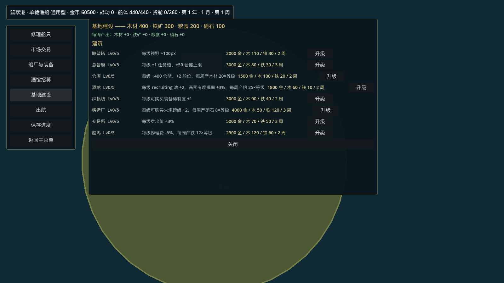

---

## 2. 建筑效果表

| 建筑 | 每级效果 | 实际接入点 |
|---|---|---|
| 总督府 | +1 任务槽、+50 仓储 | 预留（任务系统在阶段四） |
| 船坞 | 修理费 −6%，每周产铁 12 | `_repair_cost()` |
| 仓库 | +2 船位、+400 仓储，每周产木材 20 | `storage_slots()` / 买船校验 |
| 酒馆 | 招募池 +2，每周产粮 25 | `tavern_size()` / `refresh_tavern()` |
| 铸造厂 | 可购火炮磅级 +2，每周产硝石 8 | `cannon_class_cap()` / 买炮校验 |
| 织帆坊 | 可购装备稀有度 +1 | `gear_rarity_cap()` / 买装备校验 |
| 交易所 | 卖出价 +3% | `sell_bonus()` / 市场卖价 |
| 瞭望塔 | 视野 +100px | 预留（视野系统未做） |

> 解锁校验同时写在 **UI 层与购买入口**，避免绕过界面直接调用买进不合规的装备。

---

## 3. 自动化测试

| 套件 | 项数 | 结果 | 本阶段新增 |
|---|---|---|---|
| 单元 `tests/headless/run_all.gd` | 65 | 全过 | 0（建设逻辑依赖 autoload，放在集成层） |
| 集成 `tests/integration/run.tscn` | 104 | 全过 | +21 建设用例 |

新增用例：

| 用例 | 期望 |
|---|---|
| 8 座建筑载入 | 通过 |
| 初始等级 0、0 级不产出 | 通过 |
| 材料不足不能开工 | 通过 |
| 资源齐备后开工并扣料 | gold/timber/iron 正确扣减 |
| 同建筑不能重复排队 | 通过 |
| 逐周推进、最后一周完工 | 剩余周数逐周 −1，第 N 周变 Lv1 |
| 1 级仓库每周产 20 木材 | 通过 |
| 船位 = 3 + 2×仓库 + 4 | 1 级仓库 → 9 |
| 2 级船坞修理费 −12% | 通过 |
| 3 级交易所卖出 +9% | 通过 |
| 2 级铸造厂可购 7 级以下火炮 | 通过 |
| 1 级织帆坊解锁 R 级装备 | 通过 |
| 2 级酒馆招募池 10 | 通过 |
| 存档往返（等级 / 资源 / 队列） | 通过 |
| 跨周结算后资源增加 | 通过 |

---

## 4. 实机验证

| 操作 | 结果 |
|---|---|
| 打开基地建设面板 | 8 行建筑，等级 / 效果 / 造价 / 周数齐全，资源不足时价格标红、按钮灰显 |
| 点击仓库「升级」 | gold 60500→59000、木材 400→300、铁矿 300→280，队列出现 `warehouse → Lv1，剩 2 周` |
| 连推 2 周 | 仓库升到 Lv1，每周产出变为木材 +20 |

---

## 5. 发现并修复的缺陷

| # | 现象 | 根因 | 修复 |
|---|---|---|---|
| 1 | 8 座建筑全部加载失败 | 只写了 .tres，漏写 `building_def.gd` | 补上 Resource 类 |
| 2 | `from_dict` 未恢复建设数据 | 上一次编辑的目标锚点已被早前重构删除 | 改锚到 `port_stock` 段前插入 |
| 3 | 酒馆效果文案混入英文 "recruiting" | 手写数据时的笔误 | 改为"招募池" |

---

## 6. 与设计的偏差

| 项 | 设计 | 实现 | 说明 |
|---|---|---|---|
| 资源产出建筑 | 独立伐木场 / 铁矿场 / 农庄 / 硝石坑 | 作为四座既有建筑的"附属设施" | 避免再开一套 12 建筑系统；数值表一致 |
| 建造并行 | 总督府 3 级后可并行 2 项 | 当前串行队列 | 并行留到后续 |
| 仓储 | 母港有独立仓库容量 | 未做 | 货物仍只在船上，母港仓储等货物系统扩展时再接 |
| 瞭望塔 / 总督府 | 视野、任务槽 | 仅记录，未生效 | 依赖尚未实现的视野与任务系统 |

---

## 7. 收尾：交易所与跨港调拨

### 7.1 交易所四个标签页

| 标签 | 解锁等级 | 功能 |
|---|---|---|
| 行情 | Lv1 | 各港口商品买/卖价与库存一览 |
| 远洋订单 | Lv2 | 每周 3 张锁价订单，运到指定港口交付（价差 25%~60% 溢价） |
| 大宗交易 | Lv3 | 100 单位起批量买卖，买入享 5% 折扣 |
| 期货 | Lv4 | 付 20% 定金锁价，1 周内付尾款提货 |

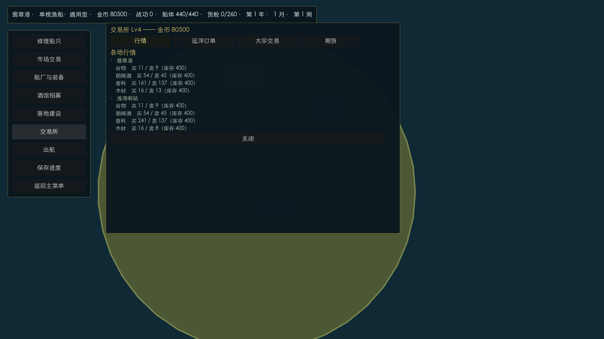

订单与期货随存档保存，每周结算推进/过期；交付必须货到目标港口。

### 7.2 跨港调拨

- 新增可停靠点：**浅湾哨站**（图 1，坐标 3400/5050），靠近后按 `E` 入港
- 哨站提供：市场买卖、本港船只换乘、远洋订单交付
- 换船时**当前船留在换乘的那个港口**（`station_port` 记录），母港列表里看不到哨站的船
- 实测：在哨站换乘后，换下的船 `station_port == map1_outpost`，母港船位数为 0

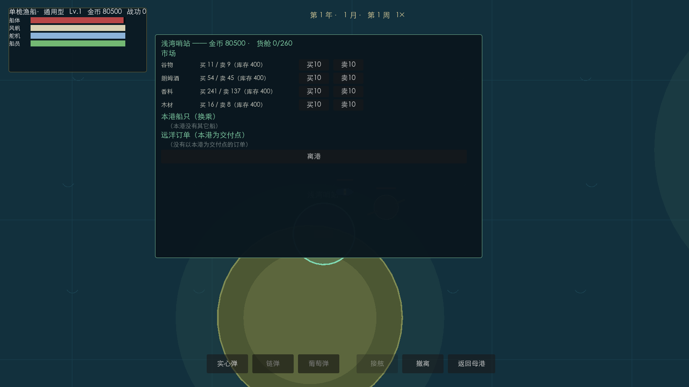

### 7.3 顺带修复：全局缺字形

发现「远洋订单」四个字中有两个字渲染成豆腐块（U+8FDC 远、U+5355 单）。
排查结论：**本机 PingFang（SC/HK/TC）都解析到 PingFang HK，而它缺这两个字形**。

| 字体 | 远 | 单 |
|---|---|---|
| PingFang SC / HK / TC | ❌ | ✅ |
| Heiti SC | ✅ | ✅ |
| Songti SC / STHeiti / Hiragino Sans GB | ✅ | ✅ |

修复方式：新增 `assets/fonts/ui_font.tres`（SystemFont，Heiti SC 优先），
在 `project.godot` 里设为 `gui/theme/custom_font`，全局生效。

---

## 8. 阶段三之后

| 优先级 | 内容 |
|---|---|
| — | ~~交易所四个标签页~~ | **已完成** |
| — | ~~港口船位与跨港调拨~~ | **已完成**（哨站可停靠、换船留港） |
| 中 | 任务系统（总督府 +1 任务槽才有落点） |
| 高 | **阶段四**：10 张图、18 个 Boss、悬赏与通缉 |


---

# 阶段四测试报告（世界内容）

| 项 | 内容 |
|---|---|
| 日期 | 2026-11-16 |
| 范围 | 10 张海图与关卡推进 · 18 个 Boss · 任务系统 · 悬赏与通缉 |
| 结论 | **通过**（自动化 264 项全绿：单元 65 + 集成 199） |
| 追加 | Boss 改为装备特异化（不做技能）· 补齐护航/采集任务 · 哨站简化为维修/交易/任务 · 存档位 UI |
| 设计依据 | `01-overall-design.md` §5；`02-systems-design.md` §4 / §9 / §10 |

---

## 1. 十张海图与关卡推进

| 图 | 海域 | 敌方等级 | 海盗主动 | 普通海盗/海怪 | Boss 海盗 | Boss 海怪 |
|---|---|---|---|---|---|---|
| 1 | 浅湾水道 | 1~3 | 否 | 4 / 2 | 「独眼」杰克 | 礁石巨蟹 |
| 2 | 珊瑚浅滩 | 3~6 | 否 | 6 / 3 | 「红胡」巴博萨 | 珊瑚海蛇 |
| 3 | 迷雾海峡 | 6~10 | **是** | 8 / 4 | 「幽灵」范德 | 迷雾水母主 |
| 4 | 商道外海 | 10~15 | **是** | 9 / 4 | 「剪径者」莫尔干 | 黑鳍鲨王 |
| 5 | 黑鲸海域 | 15~21 | **是** | 10 / 5 | 「铁钩」卡尔 | 黑鲸王 |
| 6 | 风暴角 | 21~28 | **是** | 11 / 5 | 「风暴」艾琳 | 雷暴海龙 |
| 7 | 骸骨礁群 | 28~36 | **是** | 12 / 6 | 「白骨」萨默斯 | 骸骨大王乌贼 |
| 8 | 深渊裂流 | 36~45 | **是** | 13 / 6 | 「深渊」戴维 | 深渊利维坦 |
| 9 | 王冠之海 | 45~60 | **是** | 14 / 7 | 「王冠」无名船长 | 九头蛇·涅柔斯 |

**实现要点**

- `MapDef` 10 张数据表（图 0 = 母港，图 1~9 为海域）
- 岛屿按 `island_seed` **确定性生成**（每图 4~6 座，避开出生点与航门），不手摆 10 套布局
- 敌人按地图配额生成，等级缩放 `1 + (图号−1) × 0.35`
- 3 级以上海盗进入 1200px 主动索敌
- **两道航门**：后退门（图 1 回母港，其余回上一图）、前进门（击破本图任一 Boss 后开启）
- 击破 Boss → 记录 `boss_defeated` + `cleared_maps` → 下一图航门解锁

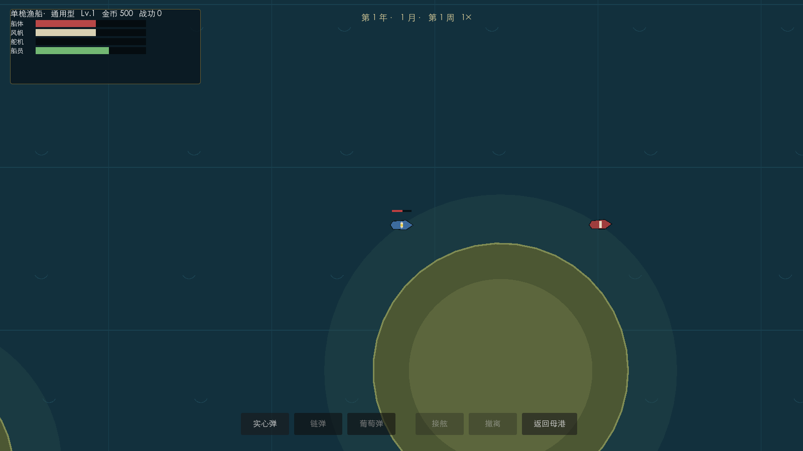

---

## 2. 十八个 Boss

| 类型 | 数量 | 实现 |
|---|---|---|
| Boss 海盗 | 9 | 放大 1.7 倍的战舰，`hp_mult` 2.2~6.8、`damage_mult` 1.3~3.0 |
| Boss 海怪 | 9 | 放大 1.8 倍，躯体 900~8200、攻击 45~170、肢体 2~4 条 |

**三阶段机制**（两种 Boss 共用阈值）：

| 阶段 | 触发 | 强化 |
|---|---|---|
| 1 | 100%~66% | 基础 |
| 2 | ≤ 66% | 伤害 ×1.3，装填 ×0.9 |
| 3 | ≤ 33% | 伤害 ×1.6，装填 ×0.8 |

- 击败后**永久移除**（`is_boss_defeated`），不重复刷新
- 战功奖励 3~25 点，装备掉率 100%

---

## 3. 任务系统

| 类型 | 内容 | 进度来源 |
|---|---|---|
| 讨伐 | 击杀 N 个海盗 / 海怪 | 击杀事件 |
| 贸易 | 赚取 N 金贸易利润 | 市场卖出的毛利 |
| 运输 | 运送 N 份商品到浅湾哨站 | 哨站交付 |

- 每周刷新 3 个，同时最多进行 3 个
- 完成后自动发放金币 + 经验 + 战功，并滚动 `EventBus.ticker`
- 任务板在母港，显示进度 `当前 / 目标`

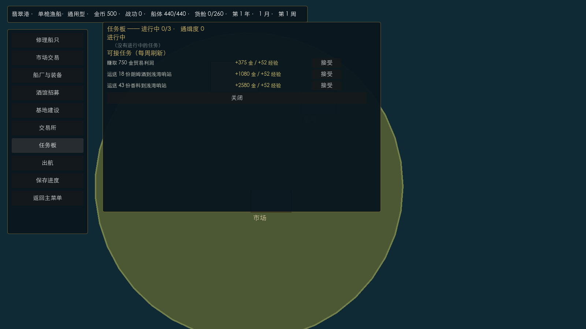

---

## 4. 悬赏与通缉

| 行为 | 通缉度变化 |
|---|---|
| 击沉海盗 / 海怪 | −2（Boss −5） |
| 击沉海军 | +15 |
| 劫掠商船 | +8 |

- 通缉度 ≥ 50 → 每 45 秒判定，最多同时在场上 2 艘**海军赏金猎人**（`navy_patrol`，按当前地图等级缩放）
- 赏金猎人一出现就锁定玩家
- 击沉后通缉度不再回涨，需自行通过打海盗或保释金降低

---

## 4.5 追加交付（按需求方第二轮反馈）

### 4.5.1 Boss 改为「装备特异化」，不做技能

| Boss | 独有装备 | 独有船员 |
|---|---|---|
| 「独眼」杰克 | 独眼罗盘旗（航速+4% 转向+6%） | 老罗盘手（瞭望 42） |
| 「红胡」巴博萨 | 红胡帆（航速+14%） | 红胡副官（大副 44） |
| 「幽灵」范德 | 幽灵舵轮（转向+22%） | 无声舵手（舵手 46） |
| 「剪径者」莫尔干 | 剪径者胸甲（装甲+60） | 剪径炮长（炮手 44） |
| 「铁钩」卡尔 | 铁钩船首像（接舷+26 转向+5%） | 铁钩打手（突击队长 48） |
| 「风暴」艾琳 | 风暴之帆（航速+19% 转向+4%） | 风暴望手（瞭望 48） |
| 「白骨」萨默斯 | 白骨甲板（装甲+85） | 白骨木匠（木匠 45） |
| 「深渊」戴维 | 深渊之旗（航速+8% 转向+10%） | 深渊引水人（操帆长 50） |
| 「王冠」无名船长 | 王冠遗物（航速+12% 转向+12%） | 王冠掌旗官（大副 50） |

- 装备稀有度 SSR~UR，击败后直接入库并播报
- 独有船员自动加入名册（UR，技能 42~50，不可重复获得）
- **海怪 Boss 不做特化**，只堆属性（按需求方要求）

### 4.5.2 任务补齐：护航与采集

| 类型 | 机制 |
|---|---|
| 护航 | 接单后海域生成一艘受护商船跟随玩家；抵达哨站即完成，商船被击沉则任务失败 |
| 采集 | 接单后海域生成 3 处沉船打捞点，靠近按 `E` 打捞 |

### 4.5.3 哨站简化为维修 / 交易 / 任务

按需求方要求**不做建造**，只保留三项：

- **维修**：按船体/帆/舵/船员缺失计价，受船坞等级减免
- **交易**：4 种商品的本地买卖
- **任务**：显示进行中任务进度，运输任务可当场交付

### 4.5.4 存档位 UI

- 主菜单直接列出 **6 个槽位**（自动 + 5 手动），显示等级 / 金币 / 所在海域
- 母港「存档」面板：逐槽保存 / 读取
- 进入母港自动写自动档

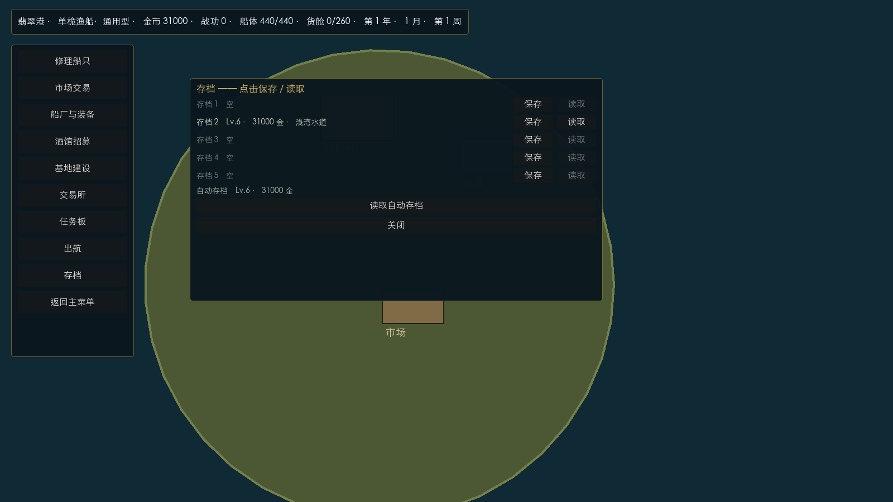

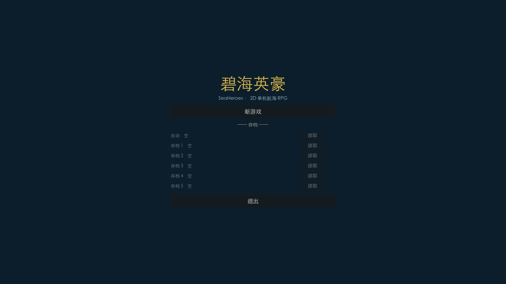

---

## 5. 自动化测试

| 套件 | 项数 | 结果 | 本阶段新增 |
|---|---|---|---|
| 单元 `tests/headless/run_all.gd` | 65 | 全过 | 0（阶段四均为系统级，走集成） |
| 集成 `tests/integration/run.tscn` | 199 | 全过 | +72 地图 / Boss / 任务 / 通缉 / 掉落 / 存档位 |

新增关键用例：

| 用例 | 期望 |
|---|---|
| 9 张海域数据载入、图 1/3/9 属性正确 | 通过 |
| 未通关时下一图锁闭 | 通过 |
| 击破 Boss 触发解锁、重复击杀不再触发 | 通过 |
| 海域场景按当前地图生成岛屿与敌人 | 图 3 生成 ≥8 个敌人、≥4 座岛 |
| Boss 刷新且 id 正确 | 通过 |
| 血量 60% → 阶段 2、30% → 阶段 3，火力提升 | 通过 |
| 击败 Boss 记入已击败并标记地图通关 | 通过 |
| 任务刷新 3 个、接受、越界拒绝 | 通过 |
| 讨伐任务进度累加并自动发奖（金币 + 战功） | 通过 |
| 贸易任务按利润累计 | 通过 |
| 通缉度：海盗 −2 / 海军 +15 / 商船 +8 | 通过 |
| 通缉度 ≥50 时海域刷出赏金猎人 | 通过 |
| 击败 Boss 掉落独有装备与 UR 船员 | 通过 |
| 护航抵达完成、商船沉没失败 | 通过 |
| 打捞点生成 3 处、靠近可采集 | 通过 |
| 存档位元数据（等级/金币/地图）可读 | 通过 |
| 哨站维修计价与执行 | 通过 |

---

## 6. 发现并修复的缺陷

| # | 现象 | 根因 | 修复 |
|---|---|---|---|
| 1 | 9 张地图全部加载失败 | 只写了 .tres，漏写 `map_def.gd` | 补上 Resource 类（这是第二次犯"只写数据不写类"的错） |
| 2 | `GameState` 解析失败，游戏起不来 | 误用 `StatsLib.xp_to_next`（该方法在 `CombatResolver`） | 改 `CRes.xp_to_next` |
| 3 | Boss 血量被放大到 40 倍 | Boss 同时吃 `hp_mult` 与按 tier 的等级缩放 | Boss 改用统一的地图缩放 `_map_scale()` |

---

## 7. 与设计的偏差

| 项 | 设计 | 实现 | 说明 |
|---|---|---|---|
| Boss 招牌技能 | 每个 Boss 独有技能 | **取消**，改为独有装备 + 独有船员 | 需求方判定：海盗 Boss 的差异应该体现在配置而非技能；海怪只堆属性 |
| 护送 / 采集任务 | 6 类任务 | **已补齐**：讨伐 / 贸易 / 运输 / 护航 / 采集 | — |
| 港口设施 | 每图 2~3 个完整港口 | 仅图 1 哨站，且只保留维修/交易/任务 | 需求方要求简化，不做建造 |
| 通缉度 >80 全图猎杀 | 更高强度 | 未单独做 | 现有编队已能体现压力 |

---

## 8. 阶段四完成后的状态

游戏已具备完整主干：

```
母港（建造/市场/船厂/酒馆/交易所/任务板）
   ↓ 出航
图 1 浅湾水道 ── 击破 Boss ──▶ 图 2 … ──▶ 图 9 王冠之海
   ↓ 途中：自动炮战 / 接舷俘获 / 战利品 / 赏金猎人
   ↓ 回港：修理 / 交易 / 换船 / 建造 / 交任务
```

**第一版可运行内容已齐备。** 明确留到后续版本的：

- Boss 进一步的特异性深化（独有技能、召唤、阶段演出）
- 其余 8 张图的港口设施
- 音乐与音效
- 美术资源替换（当前全部为程序化几何）


---

# 阶段五测试报告（系统收口）

| 项 | 内容 |
|---|---|
| 日期 | 2026-11-16 |
| 范围 | 声望三轴落地 · 战功消耗端 · 通缉保释 · 通关结算 · 帮助与引导 |
| 结论 | **通过**（自动化 409 项全绿：单元 65 + 集成 344） |
| 动机 | Demo 前的三个功能缺口：声望永远为 0（变体船买不到）、战功只进不出、打完图 9 无反馈 |

---

## 1. 声望三轴（原本只有字段，没有玩法）

### 1.1 三条获取途径

| 途径 | 数值 |
|---|---|
| **任务** | 任务带阵营，完成时该阵营 **+120** |
| **捐赠** | 1,000 金 = 10 声望，每阵营每周上限 5,000 金（50 声望） |
| **击杀** | 击沉海盗 → 海军 +3（Boss +8）、黑帆 −3；击沉海军 → 海军 −30、黑帆 +15；劫掠商船 → 商会 −40、黑帆 +15 |

### 1.2 等级与作用

| 声望 | 等级 | 作用 |
|---|---|---|
| 0~999 | 无名 | 基础服务 |
| 1,000~2,999 | 熟客 | 5% 折扣 |
| 3,000~5,999 | 盟友 | 解锁 IV~VI 级变体船 |
| 6,000~8,999 | 贵宾 | 解锁 VII~IX 级变体船 |
| 9,000~10,000 | 传奇 | 解锁 X 级变体船 |

> 这条链路打通后，**海军型 / 海盗型船体第一次真正可买**——之前声望恒为 0，船厂里那 20 个变体全是摆设。

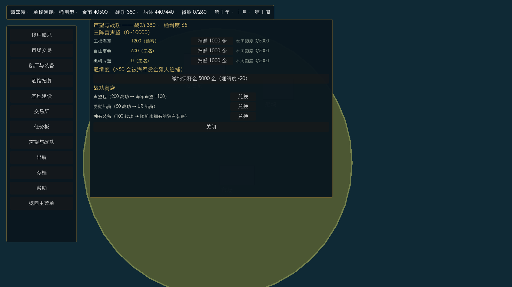

---

## 2. 战功消耗端

战功此前只从 Boss 掉，没有任何用途。现在接入商店：

| 商品 | 价格 | 内容 |
|---|---|---|
| 声望包 | 200 战功 | 指定阵营 +100 声望 |
| 受勋船员 | 50 战功 | UR 船员（技能 40~50，随机岗位） |
| 独有装备 | 100 战功 | 随机一件尚未拥有的 Boss 独有装备 |

> 这条设计让"打 Boss 攒战功"与"声望解锁变体船"两条线互相咬合：战功能换声望，声望能买船。

---

## 3. 通缉管理

- **保释金**：5,000 金 → 通缉度 −20（母港声望面板）
- **自然衰减**：每周结算时通缉度向 0 靠拢 2 点
- 通缉度 ≥50 时海军赏金猎人继续按原规则搜捕

---

## 4. 通关结算与统计

- 新增统计：击杀总数、Boss 击杀数、通关标记（全部随存档保存）
- 清空图 9 后触发通关：海域里播报「★ 通关！」，回到母港弹出结算面板（击杀数 / Boss 数 / 金币 / 战功）

---

## 5. 帮助与引导

母港新增「帮助」面板，覆盖 11 条核心说明：航行、战斗、弹药差异、接舷、撤离、航门、时间、经济、声望、存档。

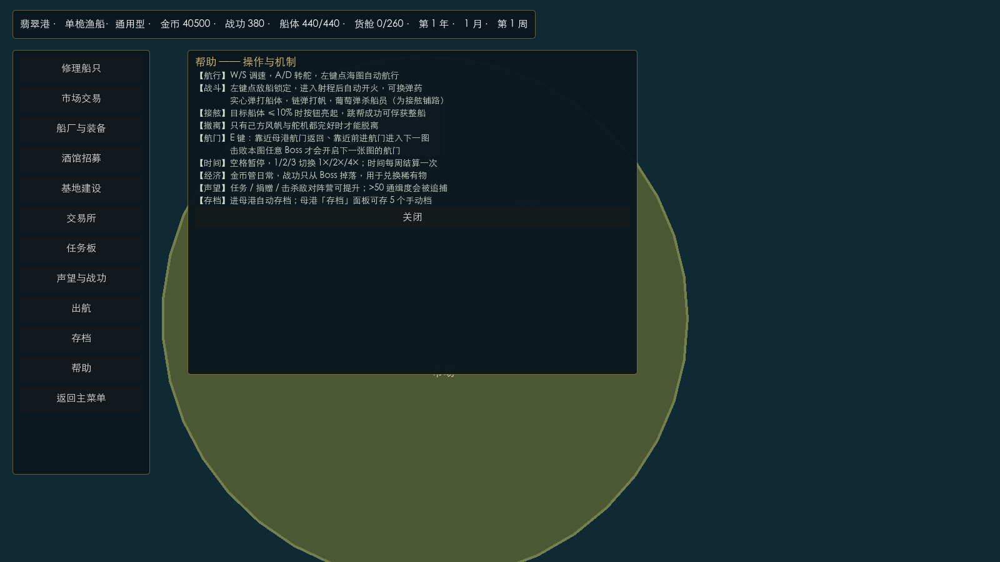

---

## 6. 自动化测试

| 套件 | 项数 | 结果 | 本阶段新增 |
|---|---|---|---|
| 单元 | 65 | 全过 | 0 |
| 集成 | 344 | 全过 | +41 声望 / 战功 / 通关，另有 104 项试玩期修复的回归用例 |

新增用例摘录：

| 用例 | 期望 |
|---|---|
| 声望累加与等级判定（1200 → 熟客） | 通过 |
| 声望不会为负 | 通过 |
| 捐赠 1000 金 → 声望 +10、扣金正确 | 通过 |
| 周捐赠额度封顶 5000、用尽后拒绝 | 通过 |
| 每周重置捐赠额度 | 通过 |
| 击沉海盗 海军 +3 / 击沉海军 黑帆 +15 | 通过 |
| 保释金 5000 → 通缉度 −20 | 通过 |
| 每周自然衰减 −2 | 通过 |
| 任务完成给对应阵营 +120 | 通过 |
| 战功不足时拒绝兑换 | 通过 |
| 三种战功商品各自扣费与发放 | 通过 |
| 清完图 9 触发通关且只触发一次 | 通过 |
| 击杀 / Boss / 通关标记随存档保存 | 通过 |

---

## 7. 发现并修复的问题

| # | 现象 | 根因 | 修复 |
|---|---|---|---|
| 1 | 声望存读档断言失败 | 测试里先打了两个敌人（+3、+8），断言却写死 0 | 改为记录存档前的真实值再比对 |

---

## 8. 至此还缺什么（Demo 交付清单）

| 项 | 状态 |
|---|---|
| 声望 / 战功 / 通缉 / 通关 / 帮助 | ✅ 本阶段完成 |
| **二轮平衡**（首轮后已调整，需再跑一次全流程） | 待做 |
| **完整回归与稳定性压测**（长时间运行、反复进出场景） | 待做 |
| **Demo 交付文档**（玩法说明、已知问题、已知限制） | 待做 |
| Boss 特异性深化、其余 8 图港口、音效、美术替换 | 明确排到后续版本 |

---

## 9. Demo 试玩期修订（阶段五之后）

Demo 交付后进行了一轮真人试玩，集中修复了 10 类问题，全部已回归：

| # | 问题 | 修复要点 |
|---|---|---|
| 1 | 点击敌船即开火 | 锁定与开火分离；最终定为**每次手动点射** |
| 2 | 锁定即宣战，低级图也会被打 | 锁定不设置敌方目标；**被打才还手** |
| 3 | 无脱战机制 | 拉开 1600px 持续 5 秒，NPC 放弃追击 |
| 4 | 出海后看不到任务 | 新增任务追踪面板 + 导航按钮 + 目标标记 |
| 5 | 护航商船无标识 | 任务行显示商船血量与距离；单位头顶阵营标签（海盗/商船/海军/同势力） |
| 6 | 高级图出场即被围殴 | 安全圈 1150px、网格密度 ≤3、最小间距 420px、围攻上限 3、索敌 1500→1100、属地巡游 |
| 7 | NPC 原地打转 | `_ai_steer` 无目标分支原本返回常量舵角 0.2，改为巡游换向 |
| 8 | 船头高频抽搐 | `turn_rate` 单位错误（度/秒被当弧度/秒，快 57 倍），改 `deg_to_rad()`；避障加滞回与侧锁定 |
| 9 | 绕岛擦边减速 | 绕航半径外扩 170px、减速按侵入深度渐进、**NPC 增加前视避障** |
| 10 | 打捞点刷进岛里 / 货舱看不见 / 撤离一键脱战 | 打捞点离岛 ≥260px；货舱面板与市场三方数量；撤离改为自动驶离 |

**玩法补充**

| 项 | 内容 |
|---|---|
| 阵营生态 | 海军↔海盗、海盗↔商船/玩家；战力优势 1.25 倍才主动追击；NPC 互殴不产出战利品 |
| 港口仓库 | 容量 `800+400×仓库等级`，市场「装船/存仓」页签，每行 `→仓`/`→船` |
| 换船校验 | 小船→大船平迁放行；超载禁止换乘并提示所需卸货量 |
| 射程可视化 | 锁定后显示射程圈，目标面板显示 `距离 X / 射程 Y` |

**测试规模变化**

| 时间点 | 单元 | 集成 | 合计 |
|---|---|---|---|
| 阶段五收尾 | 65 | 240 | 305 |
| Demo 试玩修订后 | 65 | **344** | **409** |

**交付**

| 项 | 内容 |
|---|---|
| 导出配置 | `export_presets.cfg`（macOS universal + Windows x86_64） |
| 产物 | `export/碧海英豪.app`、`SeaHeroes-macOS.zip`、`SeaHeroes-Windows.exe` |
| 文档 | `08-demo-guide.md`、`09-playtest-record.md`、`10-build-and-play.md` |
| 关键修复 | 导出后数据加载失败 → 改用 `data/manifest.txt` 清单加载 |


---

# 阶段六：0.8 ~ 0.10 迭代测试记录

> 2026-11-17 · 对应版本 0.8.0-alpha / 0.9.0-alpha / 0.10.0-alpha

## 1. 测试规模演进

| 版本 | 单元 | 集成 | 合计 | 新增内容 |
|---|---|---|---|---|
| 0.7.0-alpha | 65 | 366 | 431 | 岛屿三级、边缘换图 |
| 0.8.0-alpha | 65 | 394 | 459 | 港口服务分级、母港成长线（+28） |
| 0.9.0-alpha | 65 | 419 | 484 | 市场双页签、动态市场、阶梯溢价、投资升格（+25） |
| **0.10.0-alpha** | **65** | **433** | **498** | 世界市场全港口、升格实时、拍卖行（+14） |

## 2. 0.10.0 测试项明细

| 分组 | 用例 | 结果 |
|---|---|---|
| 拍卖行刷新 | 生成 3~5 件、货品有名称与价、挂单 2 周、同周不重复刷新 | 通过 |
| 出价规则 | 低于 1.05 倍被拒、合规出价成功、出价后玩家领先 | 通过 |
| 到期结算 | 周数递减、玩家领先扣钱入账、资金不足流拍并计违约 | 通过 |
| 升格实时 | 广播后场景内岛屿等级与名称即时更新 | 通过 |
| 经济回归 | 阶梯溢价、商品产地、投资五级、52 周升格、NPC 货流、载货 30% | 通过 |

## 3. 本轮发现并修复的问题

| # | 问题 | 修复 |
|---|---|---|
| 1 | 拍卖行船位不足时会把玩家的钱扣掉却拿不到船 | 改为整船挂单保留到下周，不扣钱 |
| 2 | 世界市场与本地市场共用面板时页签状态丢失 | 页签状态存为场景变量，切换时整面板重建 |
| 3 | 升格只写数据不刷新当前场景 | 新增 `EventBus.islands_upgraded` 广播，场景即时更新并重建港口面板 |

## 4. 结论

- 0.10.0-alpha 全部验收项通过
- 自动化 498 项全绿（65 单元 + 433 集成）
- 无遗留阻塞问题；已知优化项见 0.11.0 升级说明


---

# 阶段七：0.11.0 测试记录（黑市）

| 项 | 内容 |
|---|---|
| 日期 | 2026-11-17 |
| 版本 | 0.11.0-alpha |
| 单元 | 65 全过 |
| 集成 | 453 全过（+20） |

## 覆盖范围

| 分组 | 用例 |
|---|---|
| 开放条件 | 通缉度低时开放；≥80 时关闭；关闭一周后恢复 |
| 销赃 | 成交、数量、60% 定价、通缉度 +2、单次上限 200 |
| 违禁品 | 购买成功、入库、价格正确 |
| 私掠证 | 黑市途径（通缉度 +5）、正规途径（声望门槛） |
| 私掠效果 | 持证劫掠商船不降海军声望 |
| 存档 | 违禁品库存、私掠证状态、关闭周、拍卖行状态全部往返 |

## 本轮修复的问题

| # | 问题 | 修复 |
|---|---|---|
| 1 | 拍卖 NPC 竞价随机，导致违约用例不稳定 | `tick_auctions(npc_bid_enabled)` 增加可控参数 |
| 2 | 高价挂单（整船）测试资金不足误判为出价失败 | 测试资金提高到 5000 万 |


---

# 阶段八：0.12.0 测试记录（银行 + 违禁品实装）

| 项 | 内容 |
|---|---|
| 日期 | 2026-11-17 |
| 版本 | 0.12.0-alpha |
| 单元 | 65 全过 |
| 集成 | 471 全过（+18） |

## 覆盖范围

| 分组 | 用例 |
|---|---|
| 存款 | 存入、取出、余额、全局账户（换图后仍在） |
| 贷款前提 | 无存款不能贷、超额度被拒、已有贷款不能重复借 |
| 利率分档 | 一季 0.2%/240、半年 0.3%/780、一年 0.5%/2600（借 10000） |
| 还款 | 提前还清、结清后无贷款 |
| 破产 | 到期现金不足触发结算 |
| 违禁品 | 四种物品的消耗与加成（伪造旗帜/药物/通行证/火炮） |
| 母港黑市 | 城市级开放，功能与岛屿黑市一致 |

## 本轮修复的问题

| # | 问题 | 修复 |
|---|---|---|
| 1 | 银行面板 ScrollContainer 变量名与既有变量冲突 | 改名 bkscroll |
| 2 | 岛屿银行区「提前还款」按钮变量 rb 与拍卖行同名变量冲突 | 改名 brb |


---

# 阶段九：0.12.1 测试记录（贷款分级）

| 项 | 内容 |
|---|---|
| 日期 | 2026-11-17 |
| 版本 | 0.12.1 |
| 单元 | 65 全过 |
| 集成 | 479 全过 |

## 覆盖范围

| 分组 | 用例 |
|---|---|
| 金额分级 | 非分级金额被拒；L5 不支持一季；超出上限被拒 |
| 利息计算 | L1 一季 24、L2 半年 390、L3 一年 5200、L4 一年 13000、L5 一年 26000 |
| 多笔并发 | 两笔并存、本息总额计算、超总额被拒、6 笔上限 |
| 还款 | 单笔还清后数量减一 |
| 破产 | 到期现金不足触发结算 |
| 存档 | 新结构往返；旧单笔字段自动迁移 |

## 发现的设计细节

**本息总额校验包含利息**：借 L1 的 1,000（一季利息 24）需要存款 ≥ 1,024。
这是规则的自然结果，UI 会显示「本息总额超出存款额」并给出差额。


---

# 阶段十：0.13.0 测试记录（价格引擎）

| 项 | 内容 |
|---|---|
| 日期 | 2026-11-17 |
| 版本 | 0.13.0-alpha |
| 单元 | **66** 全过 |
| 集成 | **495** 全过（+16） |

## 覆盖范围

| 分组 | 用例 |
|---|---|
| 分段弹性 | 高/中/低库存三档系数、低库存价格显著更高 |
| 均值回归 | 25% 回归正确 |
| 噪声 | 同种子可复现、幅度受限 |
| 变动上限 | ±15% 上下限 |
| 市场事件 | 事件表 ≥8 种、供给/需求倍率、其他商品不受影响、周数递减、到期移除 |
| 周结算 | 漂移发生变化且被限制在 0.85~1.15 |

## 本轮修复的问题

| # | 问题 | 修复 |
|---|---|---|
| 1 | 分段弹性开启后，旧的「弹性为 0 时同价」单元测试失败 | 该用例改为关闭分段弹性的线性模式；新增一条分段弹性断言 |
| 2 | 测试脚本内 `var eff := me.effect_at(...)` 类型推断失败 | 显式标注 float / Array |

