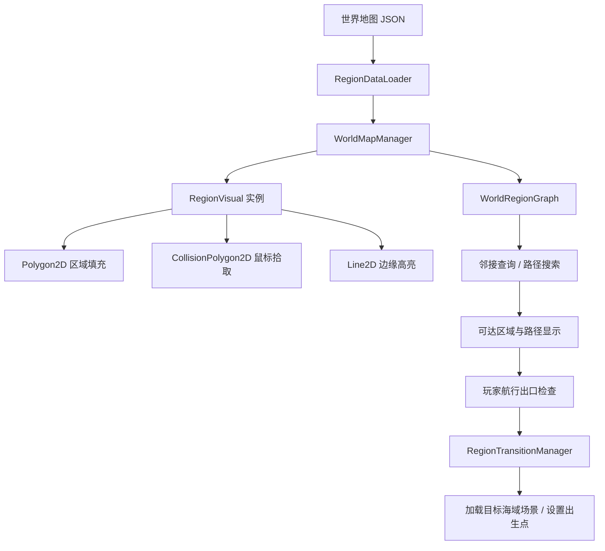
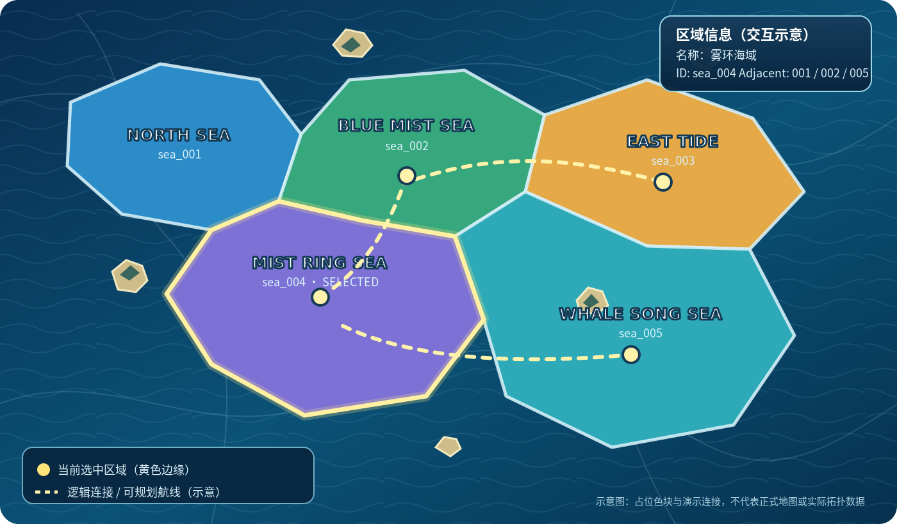
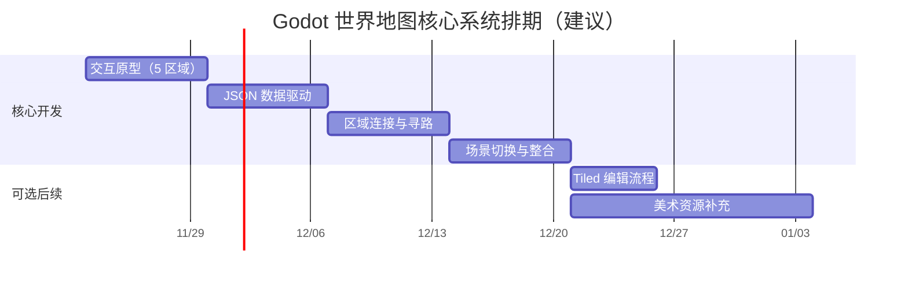

# Godot 4.6 架空海洋世界地图系统：设计参考文档

- **文档版本**：V1.0
- **编写日期**：2026-11-23
- **目标引擎**：Godot 4.6
- **开发平台**：macOS
- **脚本语言**：GDScript
- **地图表现**：2.5D 视觉效果，二维逻辑坐标
- **规划规模**：约 100 个可交互区域
- **当前资源状态**：没有美术素材，先用程序生成的纯色多边形占位

> **核心建议：先只使用 Godot 4.6。** 先完成 5 个占位海域的鼠标交互原型，再逐步加入 JSON 数据管理、区域连接、寻路和实际场景切换。Tiled 是后续可选工具，不是当前开工前置条件。

---

## 目录

1. [项目背景与设计目标](#1-项目背景与设计目标)
2. [设计原则与范围边界](#2-设计原则与范围边界)
3. [工具需求、安装入口与 macOS 兼容性](#3-工具需求安装入口与-macos-兼容性)
4. [整体技术方案](#4-整体技术方案)
5. [第一阶段地图样例](#5-第一阶段地图样例)
6. [Godot 场景结构](#6-godot-场景结构)
7. [地图数据结构](#7-地图数据结构)
8. [核心 GDScript 设计](#8-核心-gdscript-设计)
9. [区域邻接、寻路与实际航行切换](#9-区域邻接寻路与实际航行切换)
10. [Tiled 后续接入方案](#10-tiled-后续接入方案)
11. [Agent 地图数据生产约定](#11-agent-地图数据生产约定)
12. [开发排期与里程碑](#12-开发排期与里程碑)
13. [验收标准与风险控制](#13-验收标准与风险控制)
14. [开工清单](#14-开工清单)
15. [官方参考入口](#15-官方参考入口)

---

## 1. 项目背景与设计目标

### 1.1 当前已知条件

| 项目 | 当前情况 |
|---|---|
| 游戏类型 | Godot 开发的单机游戏 |
| 引擎版本 | Godot 4.6 |
| 开发系统 | macOS |
| 地图表现 | 2.5D 视觉效果 |
| 预计区域规模 | 约 100 个海域或地图区块 |
| 美术资源 | 当前没有，后续再补 |
| 地理模拟要求 | 不要求模拟板块运动、山川河流或真实地质演化 |
| 核心玩法 | 玩家在当前区域内航行，抵达合法出口后切换到相邻区域 |

### 1.2 系统目标

构建一套轻量、数据驱动、可逐步扩展的世界地图系统，支持：

1. 在一张世界地图上显示多个不规则区域。
2. 鼠标悬停时高亮区域填充或边缘。
3. 鼠标点击区域后显示区域名称、ID、状态和可到达区域。
4. 显示当前所在区域，并与鼠标悬停状态分开管理。
5. 支持世界地图缩放和拖动。
6. 维护区域之间的邻接或通行关系。
7. 根据区域连接关系规划路径。
8. 将世界地图区域连接关系映射到游戏内的出口和出生点，实现跨场景航行。
9. 后续可由 Agent 辅助创建、修改和校验区域数据。

### 1.3 非目标

本项目第一阶段不处理以下内容：

- 真实星球或球形地球投影。
- 板块碰撞、侵蚀、河流、洋流等自然地理模拟。
- 自动生成完整奇幻世界设定。
- 真实 3D 海面或 3D 地形建模。
- 正式海洋、岛屿、港口、船只美术资源。
- 在线地图服务、地图瓦片或真实 GIS 数据。

**设计重点是“区域可交互、区域关系清楚、航行切换可靠”，不是自然地理模拟。**

---

## 2. 设计原则与范围边界

### 2.1 先完成可运行原型，再扩展工具

第一版只用 Godot 4.6 自带节点和 GDScript。用纯色多边形做 5 个测试海域，暂时不安装 Tiled、不接入第三方插件、不准备美术图片。

这样可以先回答最重要的技术问题：

- 多边形区域能否正确显示？
- 鼠标是否能准确选中区域？
- 高亮、选中、当前位置三种状态是否互不干扰？
- 地图缩放和拖动后，点击区域是否仍然准确？
- 区域数据是否能从 JSON 正确加载？
- 区域之间的连接和场景切换是否符合预期？

### 2.2 地图视觉与游戏逻辑分离

地图分成四层：

| 层 | 职责 | 第一版实现 |
|---|---|---|
| 美术背景层 | 海洋底色、岛屿、装饰、纹理 | 纯色背景占位 |
| 区域显示层 | 多边形、边缘、标签 | `Polygon2D`、`Line2D`、`Label` |
| 区域数据层 | ID、名称、坐标、区域属性 | JSON |
| 导航/游戏逻辑层 | 邻接、路径、出口、场景切换 | GDScript |

正式美术资源以后可以替换背景和区域外观，但不应改变 `region_id`、区域连接关系和游戏场景切换协议。

### 2.3 二维逻辑，2.5D 表现

本方案建议将地图逻辑一直保持在二维平面：

- 区域边界使用二维多边形坐标。
- 鼠标检测使用 `Area2D` 和 `CollisionPolygon2D`。
- 相邻关系和路径使用 Graph 数据结构。
- 通过图层、阴影、描边、光效、纹理、轻微视差和 UI 层次营造 2.5D 观感。

第一版不需要真正建立 3D 世界，也不需要 Blender。将来如果确实需要旋转地球或立体地形，再单独评估 3D 方案。

### 2.4 区域邻接关系与通行规则分离

区域多边形只负责表示“区域在哪里、边界是什么样”。区域连接数据负责决定“能否从 A 去 B”。

两者不能完全绑定，原因包括：

- 两个区域看起来相邻，但可能被风暴、封锁或任务条件阻挡。
- 两个区域不直接相邻，也可能通过传送门或特殊航路连接。
- 通行可能是单向的。
- 通行可能有船只等级、任务、钥匙或其他条件。

第一版直接在 JSON 中配置连接关系，先不开发复杂的自动几何邻接算法。

---

## 3. 工具需求、安装入口与 macOS 兼容性

### 3.1 工具分级

| 工具/组件 | 现在是否需要 | 用途 | macOS 情况 |
|---|---:|---|---|
| Godot 4.6 | **必须，且已具备** | 地图显示、交互、数据加载、寻路、场景切换 | 原生支持 macOS |
| GDScript | **必须，内置** | 编写地图系统逻辑 | 随 Godot 使用，无需单独安装 |
| JSON | **必须，内置支持** | 保存地图区域和连接数据 | 无需安装 |
| Tiled Map Editor | 后续可选 | 批量绘制不规则区域、编辑区域属性 | 官方提供 macOS 构建 |
| Git | 可选 | 版本管理、回滚 Agent 的修改 | macOS 可用；若项目已使用则沿用 |
| Inkscape / Photoshop / Krita | 暂不需要 | 后期美术绘制或加工 | 不纳入当前开发依赖 |
| Blender | 不需要 | 当前不做 3D 建模 | 不需要安装 |
| YATI | 不需要 | Tiled 到 Godot 的第三方导入插件 | 本方案使用自定义 JSON 转换，不依赖它 |
| Azgaar / Cartographer / MapGen4 | 不需要 | 程序化地形生成 | 与当前目标不匹配 |
| CUDA / NVIDIA GPU | 不需要 | 本项目没有 CUDA 或本地 AI 推理需求 | 不需要 |
| Windows 虚拟机 | 不需要 | 当前工作流没有 Windows 专属工具 | 不需要 |

### 3.2 现在唯一必须的工具：Godot 4.6

官方文档入口：

- [Godot 4.6 官方文档](https://docs.godotengine.org/en/4.6/)
- [Godot 版本下载与归档](https://godotengine.org/download/archive/)

当前不需要重新安装 Godot，也不需要为地图系统单独创建另一个引擎工程。建议在现有游戏工程内建立独立的 `world_map` 目录和演示场景，避免影响原有主场景。

### 3.3 Tiled 是后续可选工具，不是开工条件

Tiled 适合在区域数量增加到几十或上百个后，以可视化方式绘制 Polygon 并编辑属性。它可以将地图导出为 JSON，其中对象层包含多边形对象、坐标和自定义属性。

- [Tiled 官网](https://www.mapeditor.org/)
- [Tiled 官方下载页（macOS / Windows / Linux）](https://thorbjorn.itch.io/tiled)
- [Tiled JSON Map Format](https://doc.mapeditor.org/en/stable/reference/json-map-format/)
- [Tiled Objects 手册](https://doc.mapeditor.org/en/stable/manual/objects/)

截至本文编写日期，官方下载页列出的 Tiled 1.12.2 macOS 安装包要求 macOS 13 或更高版本；macOS 10.12–12 可查看官方页面指向的旧版本构建。是否安装，等地图原型跑通后再决定。

**不建议在第一天就安装 Tiled。** 即使未来采用 Tiled，也只把它当作“区域边界编辑器”，不需要使用 TileSet 或把游戏项目改造成 TileMap 游戏。

### 3.4 暂时不安装第三方导入插件

Tiled 导出的是 JSON，Godot 自带 JSON 解析能力。后续可以编写一个小型 GDScript 转换器，读取 Tiled 的 Object Layer 和 Polygon 数据，再归一化为本项目自己的 `world_map.json`。

因此：

- 不需要 YATI。
- 不需要 Tiled 的游戏运行时插件。
- 不把游戏运行时绑定到外部地图编辑器。
- Tiled 文件仅作为编辑源文件；游戏最终读取项目统一的地图 JSON。

### 3.5 NVIDIA / Windows 要求

当前方案的核心工作是二维多边形渲染、鼠标拾取、JSON 解析和图搜索，不需要 CUDA，也不依赖 NVIDIA 显卡。Godot 的二维图形功能包括 Polygon、Line、2D Camera、2D 碰撞与 Area 检测；可以在现有 macOS 环境直接开发。

---

## 4. 整体技术方案

### 4.1 推荐架构



### 4.2 模块职责

| 模块 | 主要职责 | 是否第一阶段实现 |
|---|---|---:|
| `RegionVisual` | 一个区域的多边形、鼠标事件和视觉状态 | 是 |
| `RegionDataLoader` | 读取 JSON、转换坐标、基础数据检查 | 是（可先合并在 Manager） |
| `WorldMapManager` | 加载区域、维护当前/悬停/选中状态 | 是 |
| `WorldRegionGraph` | 根据 connections 构建邻接表 | 第二阶段 |
| `RegionPathfinder` | BFS / Dijkstra 路径搜索 | 第三阶段 |
| `RegionTransitionManager` | 检查出口并切换实际海域场景 | 第四阶段 |
| `TiledMapConverter` | 将 Tiled JSON 转为项目统一 JSON | 可选后续阶段 |
| `MapValidator` | 校验 ID、坐标、多边形和连接引用 | 第二阶段起逐步增加 |

### 4.3 数据流

1. 地图数据保存在 `world_map.json`。
2. Godot 启动世界地图场景时读取 JSON。
3. `WorldMapManager` 遍历 `regions` 数组。
4. 每个区域实例化一个 `RegionVisual.tscn`。
5. 将区域 ID、名称、颜色和顶点坐标传入节点。
6. `RegionVisual` 设置 `Polygon2D` 和 `CollisionPolygon2D` 的多边形。
7. 鼠标事件通过信号回传给 `WorldMapManager`。
8. Manager 更新悬停、选中和当前区域状态，并刷新 UI。
9. 导航阶段从 `connections` 构建 Graph；实际航行时再检查出口和场景目标。

---

## 5. 第一阶段地图样例

下图是为了验证交互而设计的占位地图，不是正式美术资源，也不是最终游戏地图。它使用纯色区域、边界和虚线连接来展示区域选择与航线逻辑。



[查看 SVG 矢量源文件](assets/world_map_5_regions.svg)

### 5.1 第一版只需要 5 个区域

| 区域 ID | 示例名称 | 视觉颜色 | 用途 |
|---|---|---|---|
| `sea_001` | 北风海域 | 蓝色 | 测试普通区域 |
| `sea_002` | 青岚海域 | 绿色 | 测试多方向连接 |
| `sea_003` | 东潮海域 | 橙色 | 测试远端区域 |
| `sea_004` | 雾环海域 | 紫色 | 测试当前/选中高亮 |
| `sea_005` | 鲸歌海域 | 青色 | 测试另一条通路 |

### 5.2 第一版交互状态

| 状态 | 视觉效果 | 说明 |
|---|---|---|
| 默认 | 区域基础填充色和普通边界 | 未悬停、未选中 |
| 悬停 | 填充色变亮、边缘显示亮线 | 仅随鼠标变化 |
| 选中 | 强调色边缘或持续光圈 | 点击后保持，直到选择其他区域 |
| 当前所在 | 独立的常驻标记 | 不应因鼠标离开而消失 |
| 可到达 | 显示可通行边或航线 | 第二/三阶段加入 |
| 不可到达 | 灰化或锁定标识 | 有通行条件后加入 |

`hovered_region_id`、`selected_region_id` 和 `current_region_id` 必须是三个独立变量。不要共用一个 `active_region_id`，否则鼠标移出时容易错误清除当前所在区域。

---

## 6. Godot 场景结构

### 6.1 地图演示场景

```text
WorldMapDemo.tscn
└── WorldMapDemo (Node2D)                  # world_map_manager.gd
    ├── MapContent (Node2D)
    │   ├── Background (Polygon2D)         # 第一阶段纯色背景
    │   ├── RegionLayer (Node2D)            # 动态实例化区域
    │   ├── RouteLayer (Node2D)             # 第二/三阶段绘制连接线
    │   └── Camera2D                        # 缩放与拖动
    └── UI (CanvasLayer)
        └── Root (Control)
            └── RegionInfoPanel (PanelContainer)
                └── InfoLabel (Label)
```

### 6.2 通用区域场景

```text
RegionVisual.tscn
└── RegionVisual (Area2D)                  # region_visual.gd
    ├── Polygon2D                           # 区域填充
    ├── CollisionPolygon2D                  # 鼠标命中区域
    ├── Line2D                               # 区域边界/高亮
    └── Label                                # 可选：区域名称
```

**100 个区域不需要创建 100 个独立场景文件。** 只维护一个通用的 `RegionVisual.tscn`，运行时根据 JSON 数据实例化约 100 个节点。

### 6.3 推荐项目目录

```text
res://
└── world_map/
    ├── data/
    │   └── world_map.json
    ├── scenes/
    │   ├── world_map_demo.tscn
    │   └── region_visual.tscn
    ├── scripts/
    │   ├── world_map_manager.gd
    │   ├── region_visual.gd
    │   ├── region_pathfinder.gd          # 第三阶段
    │   └── region_transition_manager.gd  # 第四阶段
    └── tools/
        └── map_validator.gd              # 第二阶段起
```

如果现有项目已经有清晰的资源目录规范，应优先沿用现有规范，不要为了本功能重排整个项目。

---

## 7. 地图数据结构

### 7.1 统一数据原则

`world_map.json` 是运行时世界地图的权威数据源。显示节点只是数据的视觉表现，不应在场景文件里重复维护一份区域 ID 和连接关系。

坐标使用一套固定二维地图坐标系，例如 `1400 × 820`。所有区域多边形、标签点和地图装饰都以地图坐标为准。Camera2D 只负责显示变换，不修改数据坐标。

### 7.2 JSON 示例

```json
{
  "schema_version": 1,
  "map_id": "ocean_world",
  "map_size": [1400, 820],
  "regions": [
    {
      "id": "sea_001",
      "name": "北风海域",
      "color": "#2C8CC8",
      "label_position": [280, 230],
      "polygon": [
        [110, 160],
        [250, 100],
        [405, 125],
        [470, 210],
        [435, 315],
        [330, 360],
        [190, 335],
        [105, 260]
      ],
      "properties": {
        "danger_level": 1,
        "unlocked": true
      }
    },
    {
      "id": "sea_004",
      "name": "雾环海域",
      "color": "#7468CF",
      "label_position": [500, 475],
      "polygon": [
        [330, 360],
        [435, 315],
        [565, 345],
        [710, 370],
        [755, 500],
        [665, 620],
        [475, 650],
        [330, 570],
        [260, 460]
      ],
      "properties": {
        "danger_level": 2,
        "unlocked": true
      }
    }
  ],
  "connections": [
    {
      "id": "conn_001_004",
      "from": "sea_001",
      "to": "sea_004",
      "bidirectional": true,
      "enabled": true,
      "cost": 1
    }
  ]
}
```

上面只是结构示例。区域坐标需要根据最终绘制结果调整，示意图中的虚线也不代表已经完成严格的多边形拓扑验证。

### 7.3 字段说明

#### Region 区域

| 字段 | 类型 | 必填 | 含义 |
|---|---|---:|---|
| `id` | String | 是 | 稳定唯一 ID，例如 `sea_001` |
| `name` | String | 是 | 地图展示名称 |
| `color` | String | 是 | 占位或基础颜色，后期可由主题覆盖 |
| `polygon` | Array | 是 | 多边形顶点坐标，至少 3 个点 |
| `label_position` | Array | 否 | 区域名称显示位置 |
| `properties` | Object | 否 | 危险等级、解锁状态等扩展字段 |
| `scene_path` | String | 后续 | 游戏内对应场景路径 |

#### Connection 区域连接

| 字段 | 类型 | 必填 | 含义 |
|---|---|---:|---|
| `id` | String | 是 | 连接关系唯一 ID |
| `from` | String | 是 | 起始区域 ID |
| `to` | String | 是 | 目标区域 ID |
| `bidirectional` | Boolean | 是 | 是否双向通行 |
| `enabled` | Boolean | 是 | 是否允许通行 |
| `cost` | Number | 否 | 路径代价，例如航行时间或距离权重 |
| `condition` | Object | 后续 | 船只等级、任务、钥匙等通行条件 |

### 7.4 为什么连接关系单独保存

不要只通过“两个多边形是否碰到”来决定玩家能不能航行。几何相邻只可以作为自动生成连接候选的依据，最终通行关系仍由 `connections` 决定。

第一版手动在 JSON 中声明连接；区域多到难以维护后，再考虑让工具根据公共边界生成候选连接，供 Agent 或开发者确认。

---

## 8. 核心 GDScript 设计

本节给出第一阶段可实现的脚本骨架。它用于说明节点职责与数据流，集成到现有工程时仍需按实际节点路径、主题和输入设置调整，并在 Godot 4.6 编辑器中运行验证。

### 8.1 `region_visual.gd`

挂载到 `RegionVisual (Area2D)`。负责一个区域自身的显示和鼠标事件，不负责查询邻居或执行场景切换。

```gdscript
class_name RegionVisual
extends Area2D

signal region_hovered(region_id: String)
signal region_unhovered(region_id: String)
signal region_clicked(region_id: String)

@onready var fill: Polygon2D = $Polygon2D
@onready var hit_shape: CollisionPolygon2D = $CollisionPolygon2D
@onready var outline: Line2D = $Line2D
@onready var title_label: Label = get_node_or_null("Label") as Label

var region_id: String = ""
var region_name: String = ""
var base_color: Color = Color("#2C8CC8")

func _ready() -> void:
    input_pickable = true
    collision_layer = 1
    mouse_entered.connect(_on_mouse_entered)
    mouse_exited.connect(_on_mouse_exited)
    input_event.connect(_on_input_event)

func configure(data: Dictionary) -> void:
    region_id = str(data.get("id", ""))
    region_name = str(data.get("name", region_id))
    base_color = Color.from_string(
        str(data.get("color", "#2C8CC8")),
        Color("#2C8CC8")
    )

    var points := PackedVector2Array()
    for point_data in data.get("polygon", []):
        if point_data is Array and point_data.size() >= 2:
            points.append(Vector2(
                float(point_data[0]),
                float(point_data[1])
            ))

    if points.size() < 3:
        push_error("Region %s has fewer than 3 polygon points." % region_id)
        return

    fill.polygon = points
    fill.color = base_color
    hit_shape.polygon = points

    var closed_points := points.duplicate()
    closed_points.append(points[0])
    outline.points = closed_points
    outline.visible = false

    if title_label != null:
        title_label.text = region_name
        var label_data: Array = data.get("label_position", [0, 0])
        if label_data.size() >= 2:
            title_label.position = Vector2(
                float(label_data[0]),
                float(label_data[1])
            )

func set_visual_state(
    is_hovered: bool,
    is_selected: bool,
    is_current: bool
) -> void:
    if is_selected:
        fill.color = base_color.lightened(0.25)
        outline.default_color = Color("#FFE47A")
        outline.width = 8.0
        outline.visible = true
    elif is_current:
        fill.color = base_color.lightened(0.15)
        outline.default_color = Color("#8BE9FF")
        outline.width = 6.0
        outline.visible = true
    elif is_hovered:
        fill.color = base_color.lightened(0.12)
        outline.default_color = Color("#FFFFFF")
        outline.width = 5.0
        outline.visible = true
    else:
        fill.color = base_color
        outline.visible = false

func _on_mouse_entered() -> void:
    region_hovered.emit(region_id)

func _on_mouse_exited() -> void:
    region_unhovered.emit(region_id)

func _on_input_event(
    _viewport: Viewport,
    event: InputEvent,
    _shape_idx: int
) -> void:
    if event is InputEventMouseButton:
        if event.button_index == MOUSE_BUTTON_LEFT and event.pressed:
            region_clicked.emit(region_id)
```

注意：`Area2D` 的鼠标拾取需要 `input_pickable = true` 且至少有一个 `collision_layer` 位启用；区域检测范围由子节点 `CollisionPolygon2D` 提供。官方文档见 [CollisionObject2D](https://docs.godotengine.org/en/4.6/classes/class_collisionobject2d.html)、[Area2D](https://docs.godotengine.org/en/4.6/classes/class_area2d.html) 和 [CollisionPolygon2D](https://docs.godotengine.org/en/4.6/classes/class_collisionpolygon2d.html)。

### 8.2 `world_map_manager.gd`

负责读取 JSON、实例化区域和维护三个核心状态。`region_scene` 在 Inspector 中指向 `RegionVisual.tscn`。

```gdscript
extends Node2D

@export var region_scene: PackedScene
@export_file("*.json") var map_data_path := \
    "res://world_map/data/world_map.json"

@onready var region_layer: Node2D = $MapContent/RegionLayer
@onready var info_label: Label = $UI/Root/RegionInfoPanel/InfoLabel

var region_nodes: Dictionary = {}
var region_data_by_id: Dictionary = {}

var hovered_region_id := ""
var selected_region_id := ""
var current_region_id := "sea_001"

func _ready() -> void:
    load_world_map()

func load_world_map() -> void:
    if region_scene == null:
        push_error("region_scene is not assigned.")
        return

    if not FileAccess.file_exists(map_data_path):
        push_error("Map JSON not found: %s" % map_data_path)
        return

    var parsed: Variant = JSON.parse_string(
        FileAccess.get_file_as_string(map_data_path)
    )
    if typeof(parsed) != TYPE_DICTIONARY:
        push_error("Map JSON root must be an object.")
        return

    var region_list: Array = parsed.get("regions", [])
    for item in region_list:
        if typeof(item) != TYPE_DICTIONARY:
            continue

        var data: Dictionary = item
        var id := str(data.get("id", ""))
        if id.is_empty() or region_nodes.has(id):
            push_error("Invalid or duplicated region id: %s" % id)
            continue

        var region := region_scene.instantiate() as RegionVisual
        if region == null:
            push_error("region_scene root must use RegionVisual script.")
            continue

        region_layer.add_child(region)
        region.configure(data)
        region.region_hovered.connect(_on_region_hovered)
        region.region_unhovered.connect(_on_region_unhovered)
        region.region_clicked.connect(_on_region_clicked)

        region_nodes[id] = region
        region_data_by_id[id] = data

    refresh_region_states()

func _on_region_hovered(id: String) -> void:
    hovered_region_id = id
    refresh_region_states()

func _on_region_unhovered(id: String) -> void:
    if hovered_region_id == id:
        hovered_region_id = ""
    refresh_region_states()

func _on_region_clicked(id: String) -> void:
    selected_region_id = id
    var data: Dictionary = region_data_by_id.get(id, {})
    info_label.text = "%s\nID: %s" % [
        str(data.get("name", id)),
        id
    ]
    refresh_region_states()

func refresh_region_states() -> void:
    for id in region_nodes.keys():
        var region: RegionVisual = region_nodes[id]
        region.set_visual_state(
            id == hovered_region_id,
            id == selected_region_id,
            id == current_region_id
        )
```

### 8.3 缩放和拖动

第一版建议使用 `Camera2D`：

- 鼠标滚轮：缩放。
- 鼠标中键拖动：平移地图。
- 限制最小和最大缩放值，避免地图缩到不可见或放大到失控。
- 区域坐标始终保留在地图本地坐标系，不要在缩放时逐个修改 Polygon 顶点。

可以将相机输入独立放进 `WorldMapCameraController.gd`，避免地图 Manager 同时负责区域数据和相机操作。第一版也可以先不做相机交互，等五区域选取完成后再加。

### 8.4 2.5D 视觉如何逐步实现

不引入 3D 模型，先用 2D 图层叠加：

1. `Background`：深蓝色海洋底色。
2. `ShadowLayer`：区域多边形轻微偏移、低透明度，制造浮起效果。
3. `RegionLayer`：实际区域填充。
4. `OutlineLayer`：边界线、悬停亮边、选中发光。
5. `DecorationLayer`：后续添加岛屿、海面纹理和航海图标。
6. `CanvasLayer`：区域信息面板、缩放按钮、导航提示。

正式美术只替换或补充视觉层，不改动区域数据模型。

---

## 9. 区域邻接、寻路与实际航行切换

### 9.1 区域图（Graph）

将每个海域看作一个节点，将每条允许通行的连接看作一条边。

```text
sea_001 ─── sea_002 ─── sea_003
    \          |
     \         |
      sea_004 ─── sea_005
```

真实拓扑以 JSON 的 `connections` 为准；上图只表示“节点与连接”的概念。

### 9.2 邻接表

从 JSON connections 构建邻接表：

```gdscript
var adjacency: Dictionary = {}

func build_graph(connections: Array) -> void:
    adjacency.clear()

    for connection in connections:
        if not connection.get("enabled", true):
            continue

        var from_id := str(connection.get("from", ""))
        var to_id := str(connection.get("to", ""))
        if from_id.is_empty() or to_id.is_empty():
            continue

        if not adjacency.has(from_id):
            adjacency[from_id] = []
        adjacency[from_id].append(to_id)

        if connection.get("bidirectional", true):
            if not adjacency.has(to_id):
                adjacency[to_id] = []
            adjacency[to_id].append(from_id)
```

上面是概念骨架。正式版本还需要检查 `from` 和 `to` 是否存在于区域字典中，并处理重复边、条件和权重。

### 9.3 选择 BFS 还是 Dijkstra

| 需求 | 算法 |
|---|---|
| 所有区域连接代价一样，只求经过最少区域数 | BFS |
| 不同海域航行时间不同 | Dijkstra |
| 同时考虑距离、危险度、燃料等权重 | Dijkstra；有合适启发式后可评估 A* |

建议先使用 BFS 验证连通关系，真正需要航行时间或危险程度权重时再升级 Dijkstra。

### 9.4 世界地图点击与真实航行的区别

需要明确区分两个动作：

- **点击区域**：选中并显示区域信息、邻居和路径。
- **玩家实际航行**：船只在当前游戏场景中抵达出口触发器，检查连接规则，然后加载目标场景。

除非游戏设计了快速旅行系统，否则世界地图点击不应绕过实际航行过程直接切换场景。

### 9.5 实际场景切换数据

后续为每条逻辑连接配置游戏场景出口映射，例如：

```json
{
  "connection_id": "conn_001_004",
  "from_region": "sea_001",
  "to_region": "sea_004",
  "from_gate_id": "east_exit",
  "to_spawn_id": "west_entry"
}
```

场景内部由 `Area2D` 或其他触发器检测玩家是否驶出。触发时调用 `RegionTransitionManager`：

1. 确认当前区域和目标区域之间存在有效连接。
2. 检查连接是否启用、是否满足条件。
3. 记录玩家状态，例如船只朝向、速度、生命值和携带状态。
4. 加载目标区域场景。
5. 在目标场景找到 `to_spawn_id` 对应出生点。
6. 恢复玩家状态，并更新 `current_region_id`。

地图上的共享边界线不需要与游戏场景的出口坐标完全重合。两者通过连接 ID、出口 ID 和出生点 ID 关联即可。

---

## 10. Tiled 后续接入方案

### 10.1 什么时候再安装 Tiled

当满足以下任一情况时再考虑引入：

- 区域数量增长到 20–30 个以上，手动编辑 JSON 顶点变得低效。
- 经常需要调整海域轮廓，想直接在底图上拖动顶点。
- 需要把区域边界绘制工作交给非程序人员。
- Agent 生成初步区域后，需要人工快速校正形状。

### 10.2 Tiled 使用范围

Tiled 仅用于：

1. 创建一个普通 2D Map。
2. 将来把世界地图图片作为 Image Layer（当前没有图片时可用空白画布）。
3. 创建名为 `Regions` 的 Object Layer。
4. 使用 Polygon Object 绘制区域。
5. 给对象添加自定义属性，例如 `region_id`、`region_name`、`color`。
6. 导出 JSON。

不需要 Tileset，不需要 Tile Layer，不需要将每个海域做成独立 Tile。

### 10.3 Tiled JSON 到项目 JSON 的转换

Tiled JSON 的 Object Layer 中包含 `objects` 数组。Polygon Object 包含对象的 `x`、`y` 和相对顶点数组 `polygon`，自定义属性放在 `properties` 中。

转换器需要：

1. 找到 `name == "Regions"` 且 `type == "objectgroup"` 的图层。
2. 遍历对象，读取 `name`、`type/class` 和 `properties`。
3. 读取对象坐标 `x/y` 及 `polygon` 顶点。
4. 将对象位置和相对顶点换算为地图统一坐标。
5. 将区域数据输出为项目自己的 `world_map.json`。
6. 连接关系仍然从单独配置或 Agent 维护，不依赖 Tiled 自动推断。

第一版 Tiled 工作流应避免对象旋转和复杂图层偏移，以降低坐标换算复杂度。待简单版本稳定后再处理这些情况。

### 10.4 为什么不使用 YATI

当前只需要读取多边形对象和属性，并不需要导入完整 TileMap。自定义 GDScript 转换器更轻量、依赖更少，也能让游戏运行时只读取标准 JSON。

---

## 11. Agent 地图数据生产约定

### 11.1 第一版不做 MCP 或独立服务

Agent 只需要能访问项目文件，就可以维护 `world_map.json`、脚本和说明文档。初期不开发 MCP Server、不引入远程 API，也不要求 Agent 操作 Godot 编辑器 GUI。

### 11.2 Agent 可以承担的任务

- 新建区域 ID、名称、颜色和顶点数据。
- 修改指定区域的 Polygon。
- 新增或删除连接关系。
- 查询某个区域的邻居。
- 检查孤立区域和无法到达的区域。
- 根据连接关系生成路径测试用例。
- 生成或更新地图数据说明。

### 11.3 建议的 Agent 操作约定

Agent 修改地图数据时应遵守：

1. 不随意修改已有 `region_id`，避免存档引用失效。
2. 新 ID 必须唯一，例如 `sea_101`。
3. 每个 Polygon 至少 3 个顶点，坐标必须落在地图坐标范围内。
4. 不直接通过 Polygon 相交关系修改游戏通行规则。
5. 新建连接时必须确认两端区域 ID 都存在。
6. 删除区域前先检查连接、场景和存档引用。
7. 修改后输出变更摘要和校验结果。
8. 对原文件先做版本控制或备份，避免 Agent 大范围覆盖。

### 11.4 后续可提供的 CLI 命令

等第二阶段以后，再考虑在项目中添加命令行校验脚本：

```bash
# 以下为计划中的自定义命令，不是 Godot 内置命令
# 实际参数解析和脚本入口需要在项目中实现

godot --headless --path . --script res://world_map/tools/map_cli.gd -- --validate
```

建议先实现 `validate`，再考虑 `build`、`list-neighbors`、`find-path` 等命令。MCP 可以作为更后面的可选接口，不是必需项。

---

## 12. 开发排期与里程碑

### 12.1 排期假设

以下按单人开发、Godot 工程已经存在、可使用 Agent 辅助生成代码、每个工作日投入约 1.5–2.5 小时（每周约 8–12 小时）估算。它是计划基线，不是固定工期承诺。若需要先熟悉 Godot 节点或调试输入事件，可在对应阶段增加缓冲时间。

**核心系统建议按 4 周推进；Tiled 接入和正式美术不纳入核心 4 周。**

### 12.2 四周核心排期

| 周次 | 阶段 | 主要任务 | 预计投入 | 交付物 |
|---|---|---|---:|---|
| 第 1 周 | 交互原型 | 创建 Demo 场景、RegionVisual、5 个占位 Polygon、悬停/点击/信息面板、基础缩放拖动 | 8–12 小时 | 可交互的 5 区域 Demo |
| 第 2 周 | JSON 数据驱动 | 定义 `world_map.json`、读取与校验数据、运行时实例化区域、分离当前/悬停/选中状态 | 8–12 小时 | JSON 驱动的地图，可用数据增删区域 |
| 第 3 周 | 区域连接与寻路 | 建邻接表、判断可达区域、BFS 路径搜索、绘制连接和规划路线、测试不可达节点 | 8–12 小时 | 可查询邻居并显示 A→B→C 路线 |
| 第 4 周 | 场景切换与整合 | 建两个测试海域场景、配置 gate/spawn、触发出口、切换场景、恢复玩家状态、回归测试 | 8–12 小时 | A 区驶出进入 B 区的完整 Demo |

### 12.3 可选扩展排期

| 阶段 | 工作内容 | 预计投入 | 什么时候做 |
|---|---|---:|---|
| 可选 A：Tiled 编辑 | 安装 Tiled、学习 Object Layer / Polygon、导出 JSON、写转换器 | 4–8 小时起 | JSON 手工维护开始吃力时 |
| 可选 B：扩展到 100 区域 | 批量创建区域数据、连接关系、地图校验、性能观察 | 视区域设计量而定 | 核心逻辑稳定后 |
| 可选 C：正式美术 | 背景图、岛屿、海洋纹理、阴影、图标和特效 | 取决于美术复杂度 | 系统验收后 |
| 可选 D：Agent 工具化 | CLI 校验、地图操作函数、MCP 接口（如确有必要） | 视自动化程度而定 | 数据维护频率提高后 |

### 12.4 每周具体任务拆分

#### 第 1 周：5 个区域的可交互原型

- [ ] 在现有项目内建立 `world_map` 目录。
- [ ] 创建 `WorldMapDemo.tscn`。
- [ ] 创建 `RegionVisual.tscn`，包含 Area2D、Polygon2D、CollisionPolygon2D、Line2D。
- [ ] 用 5 组硬编码坐标绘制不同颜色的海域。
- [ ] 实现鼠标悬停和边缘高亮。
- [ ] 实现点击区域和信息面板。
- [ ] 分离 hovered、selected、current 三种状态。
- [ ] 测试鼠标在区域边界附近移动时的反馈。
- [ ] 可选：实现 Camera2D 缩放和中键拖动。

**里程碑 M1：** 不使用任何图片或第三方工具，运行场景即可看到 5 个可交互区域。

#### 第 2 周：JSON 驱动

- [ ] 建立 `world_map.json`。
- [ ] 实现 JSON 读取和解析错误提示。
- [ ] 将区域坐标转换为 `PackedVector2Array`。
- [ ] 运行时动态实例化 `RegionVisual`。
- [ ] 校验区域 ID 唯一、顶点不少于 3 个、颜色合法。
- [ ] 将 5 个区域改为完全由 JSON 配置。
- [ ] 用 20 个测试区域检查数据规模增加后的管理方式。

**里程碑 M2：** 修改 JSON 即可改变地图区域，无需手动编辑每个场景节点。

#### 第 3 周：连接关系和路径

- [ ] 在 JSON 中维护 `connections`。
- [ ] 构建邻接表。
- [ ] 实现 `get_neighbors(region_id)`。
- [ ] 实现 `can_travel(from_id, to_id)`。
- [ ] 实现 BFS 路径搜索。
- [ ] 点击区域时高亮可到达邻居。
- [ ] 在地图上绘制连接线和规划路径。
- [ ] 测试单向连接、禁用连接和孤立区域。

**里程碑 M3：** 能正确判断邻接与可达性，并显示 A→B→C 路线。

#### 第 4 周：实际航行和场景切换

- [ ] 创建 `Sea_A.tscn` 与 `Sea_B.tscn` 两个测试场景。
- [ ] 为 A 场景设置出口触发器。
- [ ] 为 B 场景设置出生点标记。
- [ ] 配置 connection 与 gate/spawn 的对应关系。
- [ ] 出口触发时校验 Graph 通行关系。
- [ ] 加载 B 场景并将玩家放置到正确出生点。
- [ ] 更新当前区域 ID。
- [ ] 验证双向/单向通行及非法切换。
- [ ] 做一次完整回归测试。

**里程碑 M4：** 玩家能在 A 海域航行到出口，合法进入 B 海域，并从指定出生点继续航行。

### 12.5 排期依赖关系



上图是相对排期示意，以每周 5 个工作日的节奏表示；实际开始日期和投入时长可按当前项目进度调整。若不希望在 Markdown 阅读器中依赖 Mermaid，也可直接参考上面的四周任务表。

---

## 13. 验收标准与风险控制

### 13.1 第一版验收（M1）

- [ ] 运行 Godot 场景后显示 5 个形状不同的区域。
- [ ] 鼠标进入某区域时，只有该区域出现悬停效果。
- [ ] 鼠标移出后，悬停效果消失。
- [ ] 点击后区域保持选中状态。
- [ ] 当前所在区域状态不会因鼠标移出而丢失。
- [ ] 信息面板能显示区域名称和 ID。
- [ ] 如已实现缩放拖动，缩放和拖动后鼠标拾取仍准确。
- [ ] 不需要任何外部图片、插件或额外工具。

### 13.2 数据阶段验收（M2）

- [ ] 所有区域通过 JSON 加载。
- [ ] 修改坐标和颜色后，重新运行即可看到变化。
- [ ] 重复区域 ID 能被发现并报告。
- [ ] 少于 3 个顶点的区域能被拒绝。
- [ ] 不存在的连接端点能被发现。

### 13.3 导航阶段验收（M3）

- [ ] 邻居查询结果与 JSON 中 connections 一致。
- [ ] 单向和双向边行为正确。
- [ ] 禁用连接不能被路径算法使用。
- [ ] 不可达区域返回无路径，而不是错误路径。
- [ ] 路径显示与路径算法结果一致。

### 13.4 场景切换验收（M4）

- [ ] 玩家只能通过已配置且启用的出口切换区域。
- [ ] 非法目标区域不能被加载。
- [ ] 目标场景出生点 ID 存在。
- [ ] 切换后当前区域 ID 正确更新。
- [ ] 玩家必要状态得到保留或按游戏规则初始化。

### 13.5 主要风险与预防

| 风险 | 可能表现 | 预防措施 |
|---|---|---|
| 过早引入太多工具 | 安装、学习和兼容问题拖慢开发 | 第一阶段只用 Godot |
| 地图视觉与逻辑耦合 | 换美术时要重写导航 | ID 和 Graph 独立于显示节点 |
| 三种区域状态混用 | 鼠标移出导致当前区域标记消失 | hovered/selected/current 分开保存 |
| 多边形重叠或缝隙 | 鼠标命中错误、视觉边界异常 | 统一坐标系，后续加几何检查 |
| 仅凭几何自动决定通行 | 风暴、封锁、单向通道无法表达 | connections 作为最终通行依据 |
| 100 个区域手工维护困难 | JSON 顶点编辑易出错 | 稳定后引入 Tiled 或 Agent 数据工具 |
| Agent 改坏现有数据 | ID 变更、连接丢失 | 版本控制、校验、输出变更摘要 |

---

## 14. 开工清单

在开始开发之前，只需要做以下事情：

1. 在现有 Godot 工程中创建 `world_map` 目录。
2. 新建 `WorldMapDemo.tscn`，先不要替换游戏主场景。
3. 创建一个 `RegionVisual.tscn` 通用区域场景。
4. 先使用 5 组硬编码多边形坐标验证显示和鼠标交互。
5. 第一版跑通后，再将坐标迁移至 JSON。

### 第一条 Agent 开发任务提示词

可以将下面内容直接交给能访问当前 Godot 工程文件的 Agent：

```text
请基于当前 Godot 4.6 项目，创建一个独立的 WorldMapDemo 世界地图交互原型。

约束：
1. 只使用 Godot 4.6 和 GDScript。
2. 不使用第三方插件，不使用 Tiled，不使用外部美术资源。
3. 用 5 个不同形状的纯色 Polygon2D 作为海域占位区域。
4. 创建通用 RegionVisual.tscn，包含 Area2D、Polygon2D、CollisionPolygon2D、Line2D。
5. 实现鼠标悬停高亮、离开恢复、点击选择和区域信息显示。
6. hovered_region_id、selected_region_id、current_region_id 三个状态独立管理。
7. 地图 Demo 独立存在，不修改现有主场景和其他玩法逻辑。

暂不开发：
- Tiled 导入
- 100 区域生产
- 自动邻接推导
- BFS/Dijkstra 寻路
- 实际场景切换
- 任何正式美术资源

交付：
- 完整场景和 GDScript 文件
- 说明节点结构和脚本职责
- 说明如何在 Godot 4.6 中运行 Demo
- 运行并修复可发现的脚本错误
```

---

## 15. 官方参考入口

### Godot 4.6

- [Godot 4.6 文档首页](https://docs.godotengine.org/en/4.6/)
- [Polygon2D](https://docs.godotengine.org/en/4.6/classes/class_polygon2d.html)：使用顶点绘制填充多边形。
- [Area2D](https://docs.godotengine.org/en/4.6/classes/class_area2d.html)：定义可检测的二维区域。
- [CollisionObject2D](https://docs.godotengine.org/en/4.6/classes/class_collisionobject2d.html)：鼠标拾取、`input_pickable`、`input_event` 和鼠标进入/离开信号。
- [CollisionPolygon2D](https://docs.godotengine.org/en/4.6/classes/class_collisionpolygon2d.html)：为 Area2D 提供多边形检测形状。
- [Godot 4.6 功能列表](https://docs.godotengine.org/en/4.6/about/list_of_features.html)：包括 Polygon、Line、2D Camera、2D 物理与伪 3D 相关能力。

### Tiled（仅后续可选）

- [Tiled 官网](https://www.mapeditor.org/)
- [Tiled macOS 下载页](https://thorbjorn.itch.io/tiled)
- [Tiled JSON 地图格式](https://doc.mapeditor.org/en/stable/reference/json-map-format/)
- [Tiled Objects 手册](https://doc.mapeditor.org/en/stable/manual/objects/)

---

## 结论

对当前项目，最稳妥的路线不是先搭建庞大的地图生产工具链，而是：

**Godot 原生 5 区域原型 → JSON 数据驱动 → 区域连接与寻路 → 游戏场景切换 → 按需引入 Tiled → 最后补充正式美术。**

现阶段只需要现有的 macOS 和 Godot 4.6 环境。没有额外 Windows、NVIDIA、CUDA、Blender 或第三方地图插件要求。通过先小后大的实施方式，可以在每个里程碑都得到可运行成果，也能避免在系统尚未验证前投入大量工具学习和美术制作成本。
